# 云枢ERP · Yunshu ERP

> 一体化企业资源计划系统 —— 覆盖 **销售 · 采购 · 库存 · 生产 · 财务 · 人力资源 · 客户关系 · 报表** 的全流程管理。
> 业务单据审核即过账：库存、应收应付、会计凭证同步生成；开箱即带 12 个月演示数据，零外部服务、单进程即可运行。

**技术栈**：Node.js（内置 `node:sqlite`）· React 18 · TypeScript · Vite 5 · Ant Design 5 · ECharts 5
**版本**：V1.0.0　|　**默认端口**：`8787`　|　**数据文件**：`server/data/erp.db`　|　**演示账号**：`admin / admin123`

**GitHub 仓库**：<https://github.com/Amouren7/yunshu-erp>　|　**在线作品集**：<https://amouren7.github.io/yunshu-erp/>

---

## 目录

- [项目简介](#项目简介)
- [作品集](#作品集)
- [界面预览](#界面预览)
- [功能清单](#功能清单)
- [技术栈](#技术栈)
- [核心特性](#核心特性)
- [快速开始](#快速开始)
- [演示账号](#演示账号)
- [已验证](#已验证)
- [已知限制](#已知限制)
- [目录结构](#目录结构)
- [常用命令](#常用命令)
- [文档索引](#文档索引)
- [常见问题](#常见问题)

## 项目简介

云枢ERP 是一套面向制造与贸易企业的轻量 ERP 演示/实用系统。它把经典 ERP（用友/金蝶/SAP/Odoo）的核心思想压缩进一个**单进程、单数据库、前后端同仓**的实现：

- **12 种业务单据**共用一套单据引擎（`documents + document_lines + document_logs`），状态机、权限、转单、日志全部元数据驱动；
- **审核即过账**：销售发货自动扣库存、确认收入、结转成本；采购入库自动增加库存与应付；收付款自动核销发票并生成凭证；
- **移动加权平均成本**、**借贷必平的总账凭证**、**中国小企业会计准则科目表**（59 个科目，含增值税明细）；
- **11 个业务模块 · 98 条前端路由（70 个菜单入口 + 28 个隐藏详情/新建页）· 43 张数据表 · 139 个 REST 端点 · 8 个岗位角色**；
- 内置演示数据：12 个月经营流水、693 张业务单据、1,826 张凭证、182 张生产工单（含在制/已下达）、完整应收应付与账龄。

适用场景：ERP 功能演示、业务/财务流程教学、二次开发原型、小型企业内部试点。

## 作品集

如果要把本项目用于简历、面试或作品集展示，直接使用以下文件：

- 在线作品集：<https://amouren7.github.io/yunshu-erp/>
- GitHub 仓库：<https://github.com/Amouren7/yunshu-erp>

| 文件 | 用途 |
|---|---|
| [portfolio/index.html](portfolio/index.html) | 单页网页作品集（无外部依赖，可直接部署 GitHub Pages） |
| [portfolio/云枢ERP-作品集.pdf](portfolio/云枢ERP-作品集.pdf) | PDF 版，适合邮件附件、招聘平台上传与打印 |
| [portfolio/preview.png](portfolio/preview.png) | 长图预览，适合聊天工具发送 |
| [docs/09-简历与作品集.md](docs/09-简历与作品集.md) | 简历条目模板（中英文）、15 个面试问答、演示脚本、发布步骤、措辞建议 |

重新生成网页预览与 PDF：`npm run portfolio`（调用本机 Chrome/Edge）。

> 定位说明：个人项目、可运行的演示与内部试点原型，不是商用生产系统；数据均为模拟数据；项目在 AI 辅助下完成编码。详细边界见 [docs/08-交付验收报告.md](docs/08-交付验收报告.md)。

## 界面预览

| 登录 | 经营工作台 |
|---|---|
| 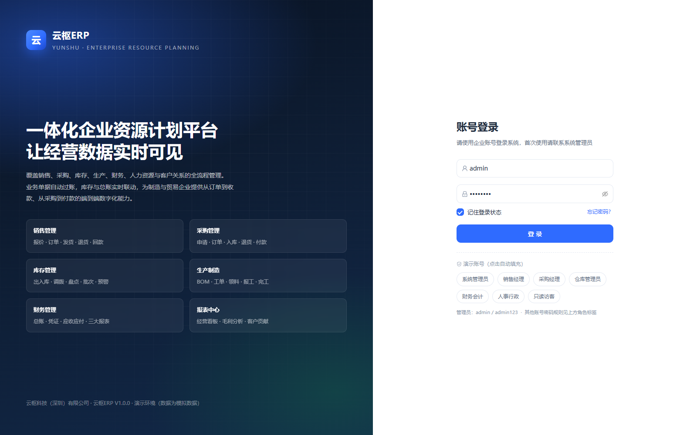 | 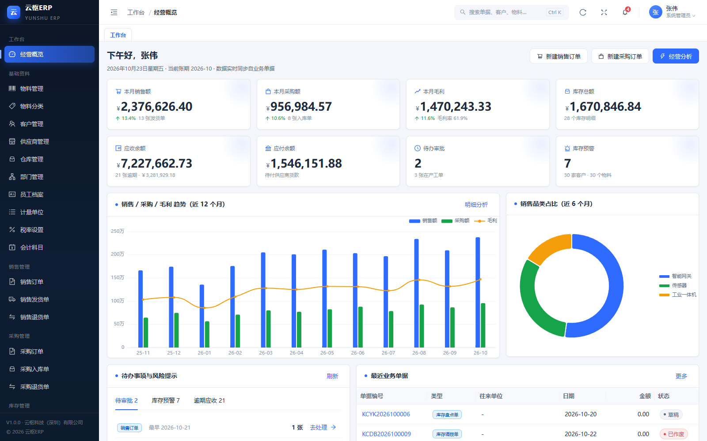 |
| **销售订单** | **销售订单详情（含凭证/日志）** |
| 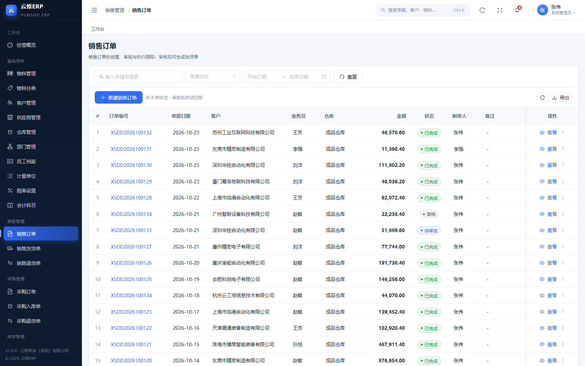 | 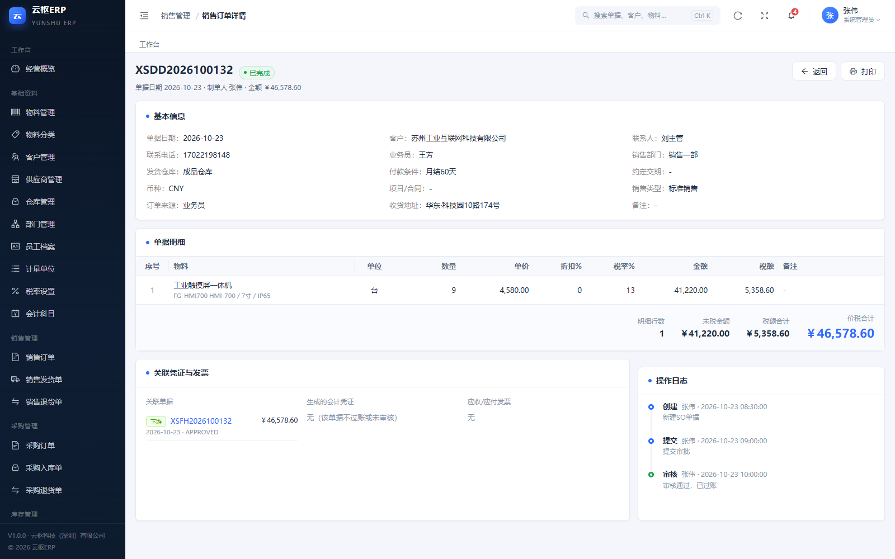 |
| **采购订单** | **库存余额** |
| 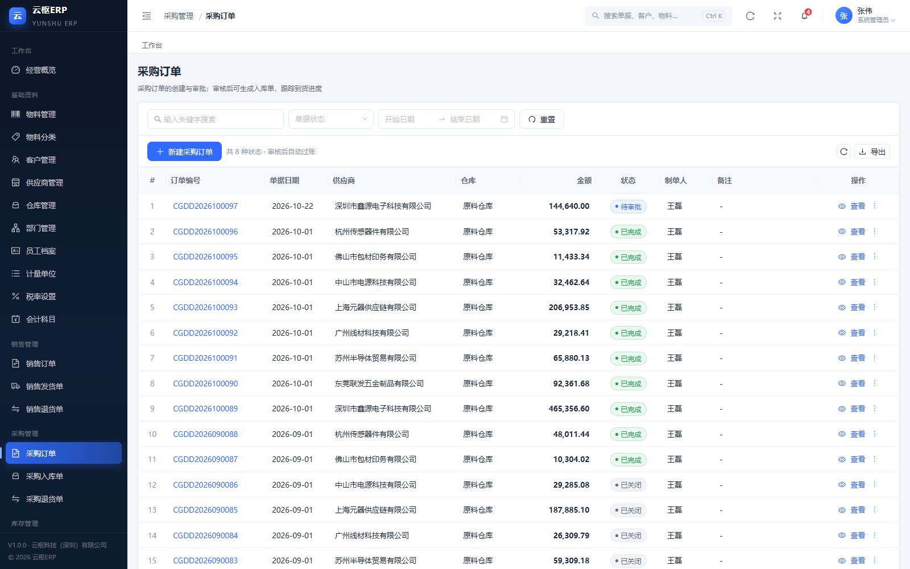 | 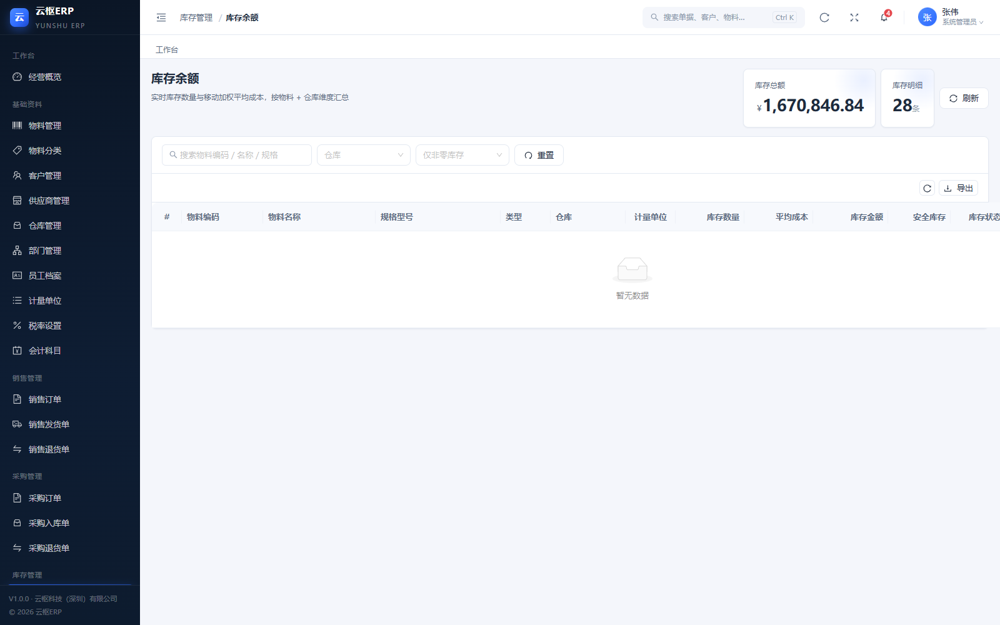 |
| **生产总览** | **生产工单详情** |
| 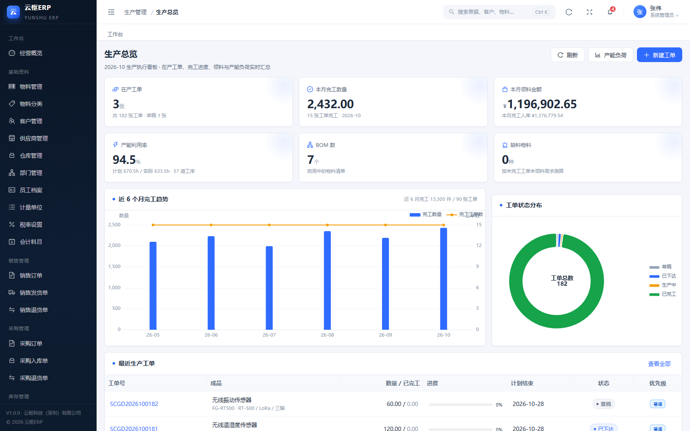 | 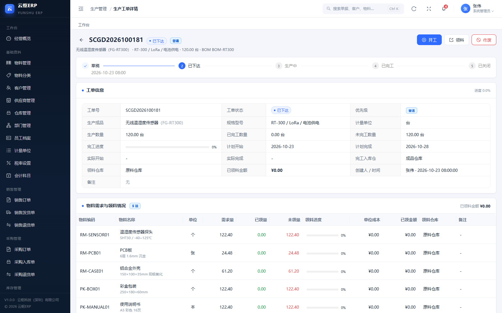 |
| **财务总览** | **财务报表（三大表）** |
| 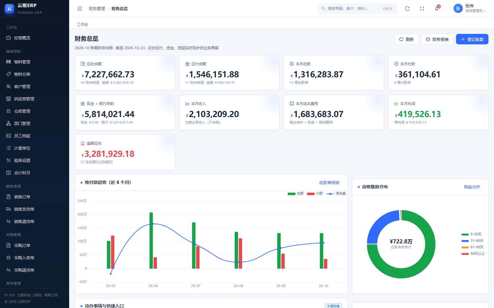 | 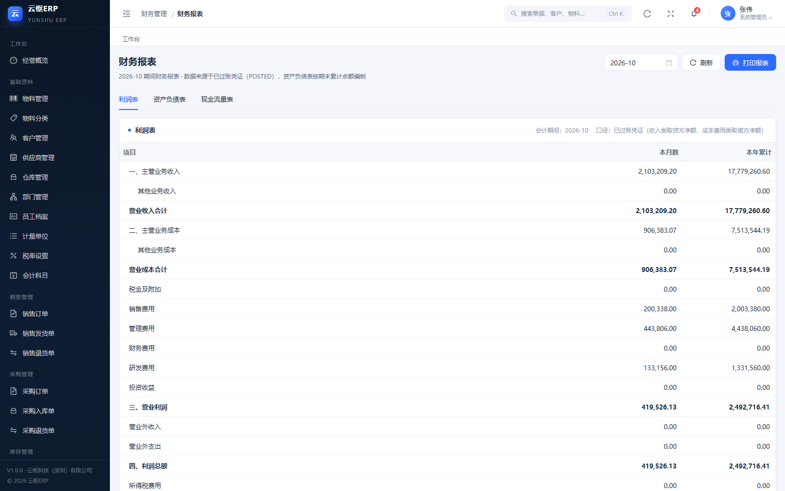 |
| **客户关系总览** | **经营驾驶舱** |
| 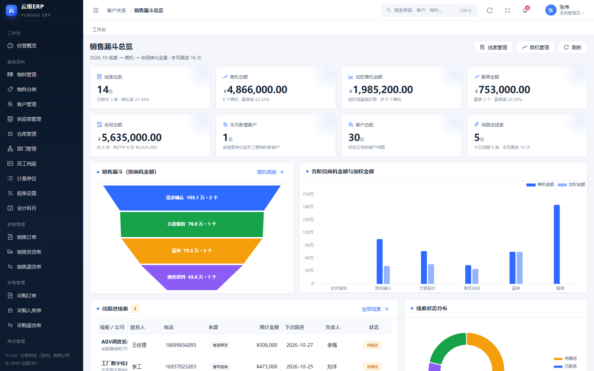 | 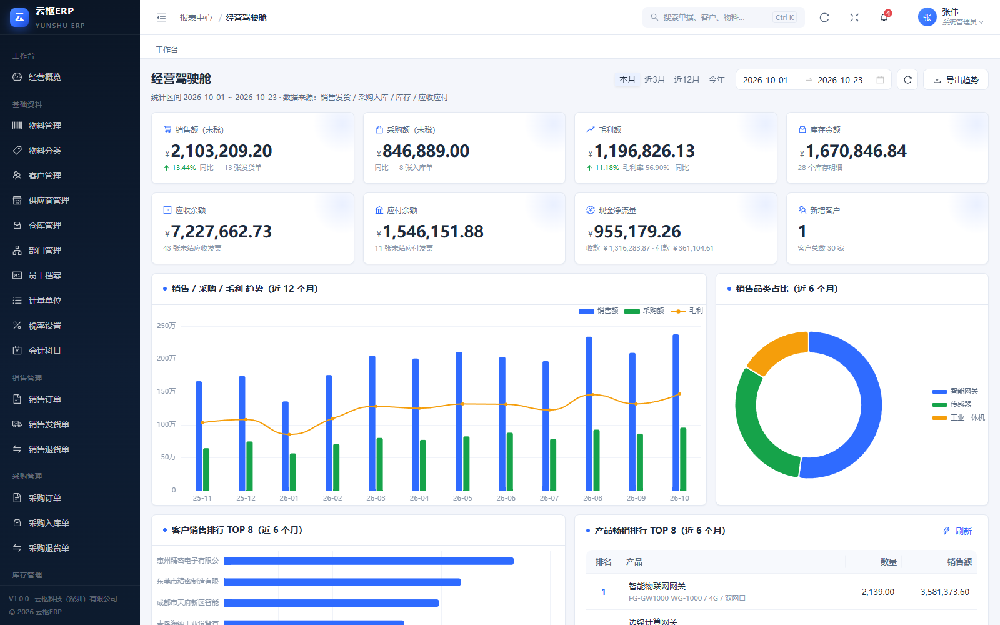 |

> 完整 33 张截图见 `docs/screenshots/`（覆盖 11 个模块与单据详情/财务报表）；由 `node scripts/final-shots.mjs` 自动拍摄，`npm run shots` 可用于按路由重拍。

## 功能清单

> 每个模块标注 **菜单入口 / 路由总数**；隐藏路由为详情页、新建页等不占菜单的页面。

### 🏠 工作台（1 / 1）
- 8 张 KPI 卡：本月销售额/采购额/毛利、库存总额、应收/应付余额、待办审批、库存预警（含环比）
- 近 12 个月销售/采购/毛利趋势、销售品类占比、客户销售排行、收付款净流量
- 待办与风险：待审批单据、库存预警、逾期应收、请假审批
- 最近业务单据、生产执行进度、全局搜索（`Ctrl/Cmd + K`）

### 📚 基础资料（10 / 10）
- 物料管理（分类、规格、多价格、安全库存、批次/效期、条码）、物料分类
- 客户管理（等级、区域、信用额度与账期、业务员归属、应收余额）
- 供应商管理（分类、结算方式、评级、应付余额）
- 仓库、部门、员工档案、计量单位、税率设置、会计科目

### 🛒 销售管理（3 / 9）
- 销售订单：草稿 → 待审批 → 已审核 → 部分发货/已发货 → 已完成/已关闭/已作废（8 种状态）
- 销售发货单：按源单部分/全部发货，审核后自动扣库存、生成应收发票与会计凭证
- 销售退货单：红字冲减收入/应收，按原成本回库
- 转单跟踪（`delivered_qty` 行级回写）、单据打印、状态时间线

### 📦 采购管理（3 / 9）
- 采购订单：草稿 → 待审批 → 已审核 → 部分入库/已入库 → 已完成/已关闭/已作废
- 采购入库单：按源单部分/全部入库，审核后自动增加库存、生成应付发票与凭证
- 采购退货单：冲减应付、进项税额转出
- 供应商账期、到货进度跟踪

### 🏭 库存管理（7 / 15）
- 实时库存余额（物料 × 仓库、平均成本、库存金额、库存状态）
- 库存流水（只增不改，可追溯单据来源与结存）
- 库存预警（低于安全库存，含缺口比例，可一键发起采购）
- 库存调拨（跨仓成本平移，不产生凭证）
- 库存盘点（盘盈/盘亏自动调整库存并生成凭证）
- 其他入库/出库（样品、赠送、借入借出、研发领用等）

### ⚙️ 生产管理（7 / 9）
- 生产工单：草稿 → 已下达 → 生产中 → 已完工 → 已关闭/已作废（含领料、报完工弹窗）
- BOM 管理（多级子件、用量、损耗率、关联工序、结构树）
- 生产总览、排产看板（逾期/今天/明天/未排期）、工作中心负荷、MRP 物料需求、工序与工作中心
- 领料过账（材料 → 生产成本）、完工入库（生产成本 → 库存商品）

### 💰 财务管理（12 / 18）
- 财务总览（应收/应付/资金/损益 KPI + 收付款趋势 + 应收账龄 + 发票与总账对账）
- 应收台账、应付台账、发票管理（核销记录 + 关联凭证 + 修改到期日/备注）
- 收款单、付款单（支持一键核销全部、多发票核销、部分收付）
- 会计凭证（自动凭证 + 手工凭证，借贷平衡校验，保存即过账）
- 三大报表（利润表 / 资产负债表 / 现金流量表，支持打印与期间切换）
- 科目余额表、明细账、账龄分析、科目映射（17 个业务科目可配置）

### 👥 人力资源（5 / 5）
- 人事总览（在职/出勤率/薪资/待审批请假/入离职/加班 + 部门人数分布）
- 考勤管理（批量生成当月考勤 + 行内编辑修正）
- 薪资管理（按月生成、批量确认、社保公积金与个税）
- 请假管理（待审批/已批准/已驳回，批准与驳回）
- 部门与编制（组织架构与薪资支出统计）

### 🤝 客户关系（6 / 6）
- 销售漏斗总览（线索/商机/赢单金额/合同/待跟进线索 + 漏斗图）
- 线索管理（来源、状态、跟进、一键转客户）
- 商机管理（阶段推进、赢率、预计成交、赢单/输单）
- 跟进记录（时间线 / 表格双视角）、合同管理（年度自动编号）、客户贡献排行

### 📊 报表中心（8 / 8）
- 经营驾驶舱（销售/采购/毛利/库存/应收应付/现金净流量 + 趋势与排行）
- 销售汇总表（按客户/产品/业务员）、销售趋势分析（环比/同比）
- 采购汇总表（按供应商/产品/月）、库存分析（仓库/分类/周转率/TOP20）
- 毛利分析（按产品/客户/单据）、客户贡献 ABC 分析、产品畅销榜（金额/数量）

### ⚙️ 系统管理（8 / 8）
- 用户管理（新增/编辑/重置密码/停用）、角色权限（模块 × 动作矩阵 + 数据范围）
- 系统参数（公司信息 + 财务与业务开关）、单据号规则（前缀/日期段/流水号）
- 通知公告、操作日志、个人信息与改密、系统信息（运行环境 + 各表数据量）

## 技术栈

| 类别 | 技术 | 说明 |
|---|---|---|
| 运行时 | **Node.js ≥ 22.5**（实测 v23.9.0） | 内置 `node:sqlite`，无需安装数据库 |
| 数据库 | **SQLite 3（WAL 模式）** | 单文件 `server/data/erp.db`，43 张表 |
| 后端 | **原生 `node:http` + 自研极简路由** | 无 Express/Koa/ORM，12 个 API 模块自动挂载，139 个端点 |
| 前端 | **React 18 + TypeScript 5** | 函数组件 + Hooks，68 个 tsx / 15,603 行 |
| 构建 | **Vite 5** | 产物 `web/dist`，由 Node 直接托管 |
| UI | **Ant Design 5** + `@ant-design/icons` | 中文 locale、自定义主题（主色 `#2f6bff`） |
| 图表 | **ECharts 5** | 仪表盘、报表可视化 |
| 路由 | **react-router-dom 6** | 基于目录 `routes.tsx` 自动注册，98 条路由 |
| 日期 | dayjs (`zh-cn`) | 表单/格式化 |
| 自动化验证 | puppeteer-core + node:test 脚本 | e2e / 全站巡检 / UI 流程 / 截图 |

## 核心特性

1. **单据引擎统一**：12 种单据共用 `documents / document_lines / document_logs`，字段/状态/动作/来源集中在 `server/lib/docTypes.mjs`，前端从 `/api/meta` 动态渲染——新增单据类型不写新表、不写新表单。
2. **审核即过账（事务内）**：`approve` 时同步完成库存变动、应收应付发票、会计凭证、来源单数量回写；失败整体回滚，已审核单据不可编辑。
3. **移动加权平均成本**：入库重算均价、出库按当前均价计价，逐笔写库存台账（只增不改）。
4. **借贷必平的总账**：每张凭证服务端校验借贷平衡（容差 0.01），科目映射 `gl_mappings` 可在系统管理调整。
5. **单据链可追溯**：`source_type/source_id/source_line_id` 贯穿转单，详情页展示来源单、下游单据、关联凭证/发票与状态时间线。
6. **元数据驱动 UI**：状态标签、动作按钮、表单字段、下拉字典均来自后端元数据，前后端不重复定义。
7. **权限到按钮**：`roles.permissions` 支持 `模块.*` 通配，菜单、路由、按钮、接口四层一致校验；角色权限矩阵可视化配置。
8. **开箱即用的演示数据**：固定随机种子生成 12 个月经营数据，报表/仪表盘/账龄全部"有数"，且可一键重建。

## 快速开始

### 环境要求

- **Node.js ≥ 22.5**（必须内置 `node:sqlite`；推荐 22 LTS / 24 LTS）
- npm ≥ 10
- Chrome / Edge（浏览与打印；自动化验证脚本需要）

### 三步启动

```bash
# 1. 安装依赖
npm install

# 2. 生成演示数据（清空重建，约 1 秒；首次自动创建 server/data/erp.db）
npm run seed

# 3. 构建前端并启动
npm run build
npm start
```

打开 **http://127.0.0.1:8787**，使用 `admin / admin123` 登录。

### 一键启动（首次最省事）

```bash
npm run boot
```

自动完成：检查依赖 → 检查/生成数据库 → 检查/构建前端 → 启动服务 → 打开浏览器。

### 开发模式（前端热更新）

```bash
npm run dev
```

- 前端（Vite HMR）：http://127.0.0.1:5173
- 后端 API（自动代理 `/api`）：http://127.0.0.1:8787

### 换端口 / 换数据目录

```bash
# Windows PowerShell
$env:ERP_PORT = "9000"; npm start
$env:ERP_DATA_DIR = "D:\erp-data"; npm start
```

更多部署、备份、重置与排错见 **[docs/07-部署与运维.md](docs/07-部署与运维.md)**。

## 演示账号

| 角色 | 用户名 | 密码 | 说明 |
|---|---|---|---|
| 系统管理员 | `admin` | `admin123` | 全部权限 |
| 销售经理 | `chenjing` | `sales123` | 销售全流程 + CRM + 报表 |
| 销售专员 | `liqiang` | `sales456` | 销售开单/提交（本人数据） |
| 采购经理 | `wanglei` | `buy123` | 采购 + 基础资料 + 报表 |
| 仓库管理员 | `zhaomin` | `stock123` | 库存全流程 |
| 财务会计 | `zhouting` | `fin123` | 财务 + 报表 |
| 人事行政 | `sunyue` | `hr123` | 人事 + 系统查看 |
| 只读访客 | `guest` | `guest123` | 各模块只读 |

> 登录页提供"演示账号"快捷标签（点击自动填充）。角色与权限可在「系统管理 → 角色权限」中调整。

## 已验证

以下验证均在 **2026-10-23 最终版本**上真实执行（Windows 11 / Node v23.9.0 / 服务 127.0.0.1:8787）：

| 验证项 | 命令 | 结果 |
|---|---|---|
| 端到端接口闭环（隔离库 + 独立端口） | `npm run e2e` | **67 / 67 通过**：认证、权限、销售 O2C、采购 P2P、生产工单全流程、19 个模块接口、业务校验 |
| 全站页面巡检（Puppeteer） | `node scripts/audit.mjs` | **73 / 73 页面正常**，0 异常、0 空白页、0 console error、0 接口错误 |
| 真实浏览器 UI 流程 | `node scripts/ui-flow.mjs` | **16 / 16 通过**：登录 → 新建销售订单 → 选客户/仓库/物料 → 保存并提交 → 审核 → 列表可见 → 打印区可见 |
| 边界与权限探针（隔离库） | `node scripts/probe.mjs` | **16 / 16 通过**：超量发货、超额核销、负库存开关、跨模块越权、数据范围、非法金额/税率/日期、SQL 注入、重复审核等 |
| 筛选下拉回归 | `npm run ui:filter` | **7 / 7 通过**：客户类型/等级/区域、供应商分类/评级、员工类型/状态，逐个打开并校验选项文案 |
| 数据勾稽自检 | `npm run check` | 负库存 **0**、借贷不平凭证 **0**、总账借 = 贷 = 114,889,299.62 |
| 财务模块 API 实测 | 见 `docs/dev/finance-api-test.md` | **168 项断言全部通过（0 失败）** |
| 生产/HR/CRM/系统/报表 API 实测 | 见 `docs/dev/ops-api-test.md` | **77 个端点全部可用**，生产工单全流程跑通 |

**最终数据快照**：客户 30 / 供应商 16 / 物料 30 / 业务单据 693 / 发票 237 / 凭证 1,826 / 库存流水 1,807 / 生产工单 182（178 已完工 + 2 已下达 + 1 生产中 + 1 草稿）；应收未收 **¥7,227,662.73**、应付未付 **¥1,546,151.88**、库存金额 **¥1,670,846.84**。

### 已内置的业务校验（2026-10-23 质量加固）

| 校验 | 行为 |
|---|---|
| 转单数量 | 发货/入库审核时重新核对源单剩余可执行数量，**重复发货/重复入库会被拒绝**（`SOURCE_QTY_EXCEEDED`） |
| 收付款核销 | 核销金额不得超过发票未结余额，防止发票与总账/资金不一致（`INVOICE_OVER_ALLOCATED`） |
| 负库存 | 系统参数「允许负库存」设为否时，出库/发货/领料会校验可用库存并拒绝（默认演示环境为开） |
| 数据范围 | `data_scope = 本人/本部门` 已对**单据**生效：列表自动过滤，详情/编辑/审核越权返回 403 |
| 单据权限 | 列表/详情按单据所属模块校验（如销售订单需 `sales.view`），不再出现跨模块越权读取 |
| 金额边界 | 折扣率、税率限定 0~100%，单价/数量不得为负，单据日期必须是真实存在的日期 |
| 常规安全 | 编码唯一、被引用主数据禁止删除、已审核单据禁止修改、重复审核拒绝、SQL 全参数化、分页上限 200 |

> 以上由 `scripts/probe.mjs`（边界与权限探针，16 项）自动验证，可随时 `node scripts/probe.mjs` 复跑。

## 已知限制

1. **生产完工成本为估算值**：完工入库单位成本由后端按「已领材料成本 × 1.18 ÷ 未完工数量」计算（1.18 为人工与制造费用估算系数）；未领料直接报完工时按物料标准成本估算。生产模块交接说明见 `docs/08-交付验收报告.md`。
2. **BOM 权限走 `basedata.*`**：BOM 管理与基础资料共用权限前缀（而非 `production.*`），只读/生产角色若只有 `production.*` 将无法维护 BOM。
3. **报表驾驶舱部分图表依赖 `dashboard.view`**：经营驾驶舱的销售/采购/毛利趋势、品类占比、客户排行来自工作台接口，只有 `reports.view` 而缺少 `dashboard.view` 时这些图表可能为空。
4. **凭证更正**：手工凭证保存即过账、不可修改；当前版本需通过反向分录做红字更正（无独立"红冲"按钮）。
5. **数据范围口径**：`data_scope` 已对单据查询/详情生效，但**仪表盘、报表中心、主数据列表仍为全局口径**（尚未按范围聚合）。
6. **单进程 SQLite**：适合演示与小型内部使用，高并发写入需前置反向代理/限流或拆分服务；默认账号密码为演示用途，正式部署务必修改。
7. **尚未实现模块**：固定资产、预算、委外加工、质检、多币种、银行对账、多级审批流（详见 `docs/08-交付验收报告.md` 扩展建议）。

## 目录结构

```text
erp-suite/
├─ package.json                # 脚本与依赖
├─ vite.config.mjs             # 前端构建（root=web，/api 代理 → 8787）
├─ tsconfig.json
├─ server/                     # 后端（9,107 行）
│  ├─ index.mjs                # HTTP 入口（静态托管 + API 路由 + 错误兜底）
│  ├─ db.mjs                   # node:sqlite 连接、事务、迁移
│  ├─ auth.mjs                 # 登录会话、密码散列、权限、审计
│  ├─ http.mjs                 # 极简 router、统一响应、分页/排序
│  ├─ schema.sql               # 43 张表 DDL
│  ├─ seed.mjs                 # 演示数据生成
│  ├─ api/                     # 12 个 API 模块（启动自动挂载，139 个端点）
│  │  ├─ auth.mjs  meta.mjs  documents.mjs  masterdata.mjs  inventory.mjs
│  │  ├─ dashboard.mjs  finance.mjs  production.mjs  hr.mjs  crm.mjs
│  │  └─ reports.mjs  system.mjs
│  └─ lib/                     # 业务内核
│     ├─ docTypes.mjs          # 单据注册表（字段/状态/转单/过账效果）
│     ├─ docService.mjs        # 校验、金额、状态迁移、详情
│     ├─ posting.mjs           # 过账效果（库存 + 凭证 + 回写）
│     ├─ stock.mjs             # 移动加权平均库存
│     ├─ gl.mjs                # 总账凭证与科目
│     ├─ numbering.mjs         # 单号/凭证号
│     └─ resource.mjs          # 通用主数据 CRUD 注册器
├─ web/                        # 前端（68 个 tsx / 15,603 行）
│  ├─ index.html
│  ├─ dist/                    # 构建产物（npm run build 生成）
│  └─ src/
│     ├─ main.tsx / App.tsx / theme.ts
│     ├─ api/                  # fetch 封装 + useRequest
│     ├─ components/           # DataTable / CrudPage / DocListPage / DocEditor / SchemaForm / …
│     ├─ layout/               # 侧边栏 / 标签页 / 全局搜索 / 通知
│     ├─ pages/                # 按模块分目录，routes.tsx 自动注册（98 条路由）
│     │  ├─ dashboard/ basedata/ sales/ purchase/ inventory/ production/
│     │  ├─ finance/ hr/ crm/ reports/ system/ login/
│     ├─ router/ store/ styles/ utils/
├─ scripts/                    # boot / dev / seed 运维 / check / e2e / audit / ui-flow / shots
├─ docs/                       # 00~09 交付文档 + dev 测试报告 + screenshots/
├─ portfolio/                  # 网页作品集、PDF、长图预览（npm run portfolio 生成）
└─ server/data/                # 运行时数据库（erp.db / -wal / -shm，不入库）
```

## 常用命令

| 命令 | 作用 |
|---|---|
| `npm install` | 安装依赖 |
| `npm run seed` | 生成/重建演示数据（清空全部业务表） |
| `npm run build` | 构建前端到 `web/dist` |
| `npm start` | 启动服务（默认 http://127.0.0.1:8787） |
| `npm run boot` | 一键启动（依赖/数据/构建/服务/浏览器） |
| `npm run dev` | 开发模式：API 8787 + Vite 5173 |
| `npm run reset` | 重置数据库并重建演示数据（需先停服） |
| `npm run check` | 数据自检（负库存、借贷平衡、总额核对等） |
| `npm run e2e` | 端到端接口闭环验证（隔离库 + 独立端口，67 项断言） |
| `node scripts/probe.mjs` | 边界与权限探针（隔离库，16 项：越权/超量/负库存/非法金额等） |
| `npm test` | 同 `npm run e2e` |
| `node scripts/audit.mjs` | 全站页面巡检（73 个路由，检查空白页/控制台错误/接口错误） |
| `node scripts/ui-flow.mjs` | 真实浏览器 UI 流程验证（16 项） |
| `npm run ui:filter` | 筛选下拉回归（7 个下拉选项与筛选生效校验） |
| `node scripts/final-shots.mjs` | 生成 `docs/screenshots/` 的 33 张最终截图 |
| `npm run shots` | 按指定路由截图 QA（输出到 `qa-shots/`） |

## 文档索引

| 文档 | 内容 |
|---|---|
| [docs/00-REA安装与使用报告.md](docs/00-REA安装与使用报告.md) | 逆向分析工具 REA 的安装、验证与使用案例 |
| [docs/01-ERP功能分析.md](docs/01-ERP功能分析.md) | 对标 ERPNext / Odoo / 用友金蝶的 224 条功能矩阵 |
| [docs/02-业务流程蓝图.md](docs/02-业务流程蓝图.md) | O2C / P2P / 生产 / 库存流程与总账分录规则 |
| [docs/03-种子数据方案.md](docs/03-种子数据方案.md) | 演示数据规模、状态覆盖、一致性校验 |
| [docs/04-模块落地清单.md](docs/04-模块落地清单.md) | 单据状态机、前后端拆解、实施排期、验收用例 |
| [docs/05-用户手册.md](docs/05-用户手册.md) | **11 个模块完整操作手册**（含财务/生产/HR/CRM/系统/报表） |
| [docs/06-架构说明.md](docs/06-架构说明.md) | 分层架构、单据引擎、过账/总账、权限、API 约定、数据模型 |
| [docs/07-部署与运维.md](docs/07-部署与运维.md) | 环境、安装、构建、启动、备份恢复、重置、排错 |
| [docs/08-交付验收报告.md](docs/08-交付验收报告.md) | 交付物清单、验证命令与结果、3 分钟演示脚本、后续扩展建议 |
| [docs/09-简历与作品集.md](docs/09-简历与作品集.md) | 简历写法、面试问答、演示脚本、作品集发布与措辞建议 |
| [docs/dev/finance-api-test.md](docs/dev/finance-api-test.md) | 财务 API 实测报告（168 断言） |
| [docs/dev/ops-api-test.md](docs/dev/ops-api-test.md) | 生产/HR/CRM/系统/报表 API 实测报告 |

## 常见问题

- **双击 `启动ERP.cmd` 窗口一闪而过**：旧版脚本用了 LF 换行，`cmd.exe` 会把命令拆错后立即退出。现已修复（CRLF + 错误提示 + `pause` 兜底）；若仍遇到，运行 `npm run launcher` 重新生成，或直接命令行 `npm run boot`，也可先跑 `npm run verify:launcher` 自检。
- **启动后提示"检测到云枢ERP已在运行"**：说明服务已经在跑（重复双击时会出现），浏览器会自动打开，无需再次启动。
- **启动报 `Cannot find module 'node:sqlite'`**：Node 版本低于 22.5，请升级 Node。
- **页面空白 / 提示"前端尚未构建"**：先 `npm run build`，再 `npm start`。
- **列表没有数据**：执行 `npm run seed` 生成演示数据（会清空现有业务数据）。
- **审核单据提示"当前状态「DRAFT」不允许执行审核"**：需要先「提交」再「审核」。
- **想重置演示数据**：停止服务 → `npm run seed`（或 `npm run reset`）。
- **端口被占用**：`$env:ERP_PORT="9000"; npm start`；启动脚本也会自动识别"已在运行"并直接打开浏览器。

完整排错表见 **[docs/07-部署与运维.md §11](docs/07-部署与运维.md#11-常见问题排查faq)**。

## 说明

- 本项目为**演示与交付用途**，内置"云枢科技（深圳）有限公司"及其客户/供应商/物料均为模拟数据，不涉及真实商业信息。
- 系统默认仅监听 `127.0.0.1`（本机访问）；如需局域网使用，请参考部署文档调整监听地址并配置防火墙/反向代理。
- 采用 **MIT 许可证**，详见 [LICENSE](LICENSE)。
- 技术选型与功能分析参考了 ERPNext、Odoo、Frappe HRMS 等开源项目（均为独立许可证），仅参考设计思想，未复制其代码。
