# 05 用户手册

- 文档版本：v1.0（完整版）
- 编写日期：**2026-10-23**
- 适用版本：云枢ERP V1.0.0
- 适用账号：全部角色（不同角色可见菜单/按钮不同，见 `06-架构说明.md` §7）
- 配套截图：`docs/screenshots/`（33 张，覆盖 11 个模块；由 `node scripts/final-shots.mjs` 拍摄）

> **本版覆盖范围**：全部 11 个模块 —— 登录、工作台、基础资料、销售管理、采购管理、库存管理（第 1~6 章），财务管理、生产管理、人力资源、客户关系、系统管理、报表中心（第 7~12 章）。
> 手册基于 2026-10-23 13:50 的最终代码与截图编写，所有菜单名、按钮名、字段名均与页面一致。

---

## 0. 使用说明

### 0.1 如何阅读

- 每个模块按「功能概述 → 界面说明 → 操作步骤 → 状态与规则 → 注意事项」组织。
- 步骤中的按钮名与页面显示一致（如「保存并提交」「审核」「导出」）。
- 状态用大写英文值表示（如 `DRAFT`），界面显示对应中文（如「草稿」），对照表见附录 A。
- 菜单路径写作 `模块 → 页面`，如 `销售管理 → 销售订单`。

### 0.2 通用术语

| 术语 | 含义 |
|---|---|
| 单据 | 一次业务动作的凭证载体，如销售订单、采购入库单、收款单 |
| 草稿（DRAFT） | 可自由编辑，未进入审批流程，不产生任何库存/财务影响 |
| 提交（SUBMITTED） | 已送审，等待有权限的人审核；仍可作废，但不可编辑 |
| 审核（APPROVED） | 已生效：自动过账（库存、发票、会计凭证），不可再编辑 |
| 源单 | 生成当前单据的上游单据（如发货单的源单是销售订单） |
| 转单 | 由源单带出明细生成下游单据（支持部分数量） |
| 核销 | 收款/付款与发票的对应关系（支持部分核销） |
| 价税合计 | 未税金额 + 税额 |
| 移动加权平均成本 | 每次入库后重算库存均价，出库按当前均价计价 |
| 过账 | 审核时生成库存流水与会计凭证的动作 |

---

## 1. 通用操作

### 1.1 登录与退出

1. 打开浏览器访问系统地址（默认 **http://127.0.0.1:8787**）。
2. 在登录页输入用户名、密码（默认已填入 `admin / admin123`）。
3. 点击「登 录」按钮进入工作台。
4. 登录页右侧「演示账号」标签可点击自动填充（管理员 + 6 个岗位角色）。


- **退出登录**：右上角头像 → 下拉菜单 →「退出登录」。
- **修改密码**：头像菜单 →「修改密码」（进入个人中心）。
- **会话时长**：登录状态默认保持 7 天，过期需重新登录；页面提示"登录已过期"时刷新并使用正确账号登录。

### 1.2 界面布局

```
┌──────────────────────────────────────────────────────────────────────┐
│ 顶栏：折叠按钮 | 面包屑 | 全局搜索(Ctrl+K) | 刷新 | 全屏 | 通知 | 用户 │
├──────────┬───────────────────────────────────────────────────────────┤
│ 侧边菜单  │ 标签页栏（访问过的页面，可关闭；首页不可关闭）              │
│ 按模块分组 │                                                           │
│ 一级导航  │ 页面内容区（页头 + 筛选 + 表格/表单）                       │
│          │                                                           │
│ 底部版本  │                                                           │
└──────────┴───────────────────────────────────────────────────────────┘
```

- **左侧菜单**：按「工作台 / 基础资料 / 销售管理 / 采购管理 / 库存管理 / …」分组，只显示当前角色有权限的菜单。
- **折叠**：点击顶栏左侧 ☰ 可收起/展开侧边栏，状态会被记住。
- **标签页**：打开过的页面会形成标签，点击切换；点 × 关闭；`工作台` 首页不可关闭。
- **面包屑**：显示「模块 / 当前页面」，如 `销售管理 / 销售订单`。
- **全屏**：顶栏 ⛶ 按钮切换浏览器全屏，适合演示/投影。

### 1.3 全局搜索（Ctrl / Cmd + K）

1. 按 **Ctrl+K**（macOS 为 ⌘K）或点击顶栏搜索框。
2. 输入单据号、客户名、供应商名、物料编码/名称/规格，结果按「业务单据 / 客户 / 供应商 / 物料」分组。
3. 点击结果：业务单据跳转对应详情页，客户/供应商/物料跳转对应管理页。

> 提示：搜索有约 260ms 防抖，输入后稍等结果出现；无结果会提示「未找到…的相关结果」。

### 1.4 消息通知

- 顶栏铃铛图标显示未读数，点击弹出通知列表（通知/提醒/预警三类）。
- 点击「查看全部」跳转系统通知页。
- 通知由系统生成（如库存预警、月末结账提醒），管理员可在系统管理维护。

### 1.5 列表页通用功能

绝大多数列表页（客户、物料、单据、凭证等）采用同一套交互：

| 区域 | 功能 |
|---|---|
| 搜索框 | 按关键字（编码/名称/单号/备注等）检索，回车或清空后生效 |
| 筛选器 | 下拉/日期范围筛选，**选择后自动刷新**（无需点查询） |
| 重置 | 清空全部筛选条件并回到第 1 页 |
| 刷新按钮 | 重新加载当前页数据 |
| 导出按钮 | 将**当前筛选条件**下的数据导出为 CSV（Excel 可直接打开，含 UTF-8 BOM） |
| 分页 | 右下角切换页码与每页条数（10/20/50/100/200） |
| 行操作 | 「查看」/「编辑」/「删除」或「更多」下拉菜单 |
| 序号列 | 固定在最左侧，# 为当前页行号 |

### 1.6 单据列表页通用功能

销售订单、采购订单、发货单、入库单、调拨单等单据列表额外具备：

- **状态筛选**：下拉列出该单据全部状态（如销售订单 8 种状态）。
- **日期范围**：按单据日期过滤。
- **新建按钮**：右上角「新建 xxx」进入编辑页（无权限时隐藏）。
- **行操作「更多」菜单**（按当前状态动态出现）：

| 菜单项 | 出现条件 | 说明 |
|---|---|---|
| 查看详情 | 始终 | 进入详情页 |
| 编辑单据 | `DRAFT` 且有编辑权限 | 进入编辑态 |
| 打印单据 | 始终 | 打开 A4 打印视图 |
| 提交 | `DRAFT` 且有提交权限 | 草稿 → 待审批 |
| 审核 | `SUBMITTED` 且有审核权限 | **过账**：库存/发票/凭证生成 |
| 关闭 | `APPROVED` / 部分执行 / 全部执行（销售/采购订单） | 未执行完的部分不再执行 |
| 作废 | `DRAFT` / `SUBMITTED` | 单据失效 |
| 删除单据 | `DRAFT` / `VOID` 且有删除权限 | 物理删除，不可恢复 |

### 1.7 单据编辑页通用操作

新建或编辑单据（`销售管理 → 销售订单 → 新建` 等）时：

1. **填写表头**：必填项带红色星号（如客户、仓库、单据日期）。
2. **添加明细**：点击「添加明细行」，在行内选择物料；选择后自动带出名称、规格、单位、税率、参考价。
3. **编辑行**：可修改数量、单价、折扣%、税率、批号/仓库（按单据类型显示不同列），金额与税额自动计算。
4. **删除行**：行末删除图标。
5. **查看合计**：表格下方显示「明细行数 / 未税金额 / 税额合计 / 价税合计」。
6. **保存**：
   - 「保存草稿」→ 状态 `DRAFT`，可继续修改；
   - 「保存并提交」→ 直接进入 `SUBMITTED` 待审批。
7. **提交/审核**：进入详情页后，页头右侧显示当前状态可执行的动作按钮（提交/审核/关闭/作废）。

> 单据一旦「审核」（APPROVED）即不可修改，只能作废或关闭；如需更正请使用退货/红字单据（见各模块说明）。

### 1.8 打印

- 单据详情页右上角「打印」按钮（或列表「更多 → 打印单据」）：浏览器打印预览只显示 A4 单据（公司抬头、明细、合计、价税大写、签字栏）。
- 建议在打印设置中勾选「背景图形」、纸张选 A4、边距选默认。
- 打印为纯前端行为，不改变单据状态；系统预留了打印次数统计字段（当前界面未展示）。

### 1.9 权限差异

- 无权限的菜单不会显示；无权限的按钮不会出现。
- 只读账号（`guest`）可查看与导出，不能新建/修改/审核。
- 审核、删除等高风险操作会弹二次确认框。

---

## 2. 登录与工作台

### 2.1 功能概述

工作台是登录后的首页（`/dashboard`），用于快速掌握经营状况、处理待办与风险。

### 2.2 界面说明

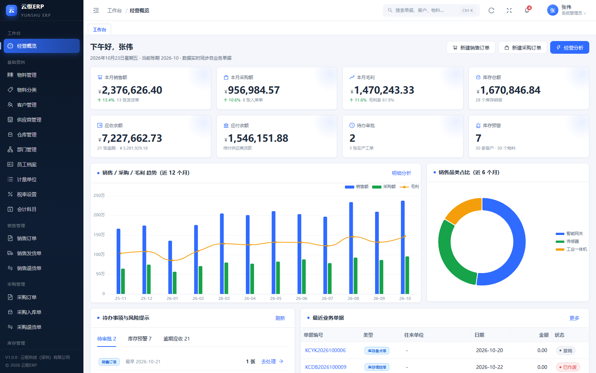

| 区域 | 内容 |
|---|---|
| 页头问候 | 「上午好，张伟」+ 当前日期 + 当前账期 + 快捷按钮（新建销售订单 / 新建采购订单 / 经营分析） |
| KPI 卡（8 张） | 本月销售额、本月采购额、本月毛利、库存总额、应收余额、应付余额、待办审批、库存预警；带环比百分比与辅助说明 |
| 销售/采购/毛利趋势 | 近 12 个月柱线组合图 |
| 销售品类占比 | 近 6 个月环形图 |
| 待办事项与风险提示 | 三个标签：待审批（按单据类型 + 请假）、库存预警、逾期应收 |
| 最近业务单据 | 最近 9 张单据（单号/类型/往来单位/日期/金额/状态） |
| 客户销售排行 | 近 6 个月 Top 客户横向柱状图 |
| 收付款净流量 | 近 6 个月收款/付款/净流量图 |
| 生产执行 | 最近生产工单及进度 |

### 2.3 操作步骤

1. 点击任意 **KPI 卡**可跳转到对应明细页（如「本月销售额」→ 发货单列表；「库存总额」→ 库存余额）。
2. **处理待办**：在「待审批」标签点「去处理」，跳转到对应单据列表；「请假申请」跳转人事请假页。
3. **处理库存预警**：在「库存预警」标签点「查看全部预警」进入库存预警页；或点单条物料查看。
4. **处理逾期应收**：在「逾期应收」标签点「查看应收台账」。
5. **新建单据**：右上角快捷按钮直接进入新建销售订单 / 采购订单。
6. **经营分析**：点「经营分析」进入报表中心的 KPI 看板。
7. **刷新待办**：待办卡片右上角「刷新」。

### 2.4 说明

- 工单卡片、最近单据均可点击进入详情（按权限）。
- KPI 数据来自业务单据实时汇总，日期口径为「本月」；趋势为近 12 个月。

---

## 3. 基础资料

基础资料是全部业务的"字典"，**没有维护基础资料就无法开单**。建议首次使用时按以下顺序检查：物料分类 → 计量单位 → 物料 → 客户/供应商 → 仓库 → 部门/员工 → 会计科目。

> 基础资料页面统一由「列表 + 新增/编辑抽屉 + 详情抽屉」组成：右上角「新增 xxx」，行内「详情 / 编辑 / 删除」，支持搜索、筛选、重置、导出与分页。

### 3.1 物料管理

**路径**：`基础资料 → 物料管理`

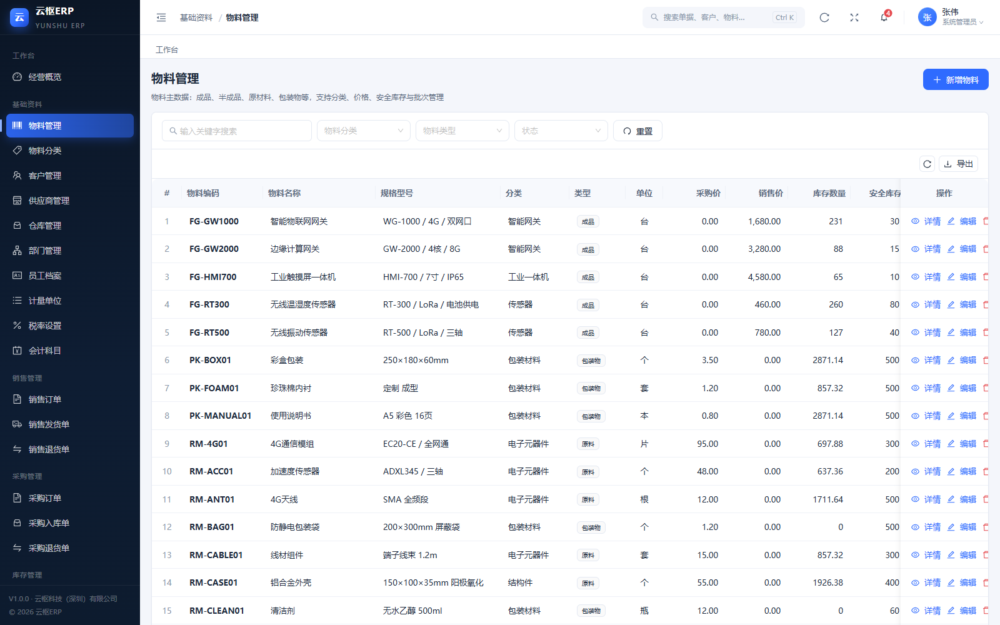

**列表列**：物料编码、名称、规格型号、分类、类型、单位、采购价、销售价、库存数量、安全库存、状态。

**筛选项**：物料分类、物料类型（原料/半成品/成品/服务/虚拟件/包装物）、状态（启用/停用）。

**新增/编辑字段**（抽屉）：

| 字段 | 说明 |
|---|---|
| 物料编码* / 名称* | 唯一编码，建议 `品类-型号` 规则（如 `FG-GW1000`） |
| 规格型号、品牌、条码、产地 | 辅助识别 |
| 物料分类、物料类型、计量单位 | 影响报表分类与库存科目 |
| 参考采购价 / 参考销售价 / 标准成本 | 开单时自动带价 |
| 税率% | 默认 13，开单时按行取用 |
| 安全库存 / 最高库存 | 库存预警依据 |
| 批次管理、保质期(天) | 启用后出入库需录批号 |
| 状态 | 启用/停用（停用后不能开单选择） |

**操作要点**：

- 删除物料前会检查是否被单据/BOM/库存流水/工单引用，被引用时禁止删除。
- 「详情」抽屉可查看库存数量与金额。

### 3.2 物料分类

**路径**：`基础资料 → 物料分类`

- 维护分类编码、名称、上级分类、排序、状态（ENABLED/DISABLED）。
- 分类用于物料筛选、库存汇总、销售品类占比与报表分类。
- 删除前会检查是否被物料或子分类引用。

### 3.3 客户管理

**路径**：`基础资料 → 客户管理`

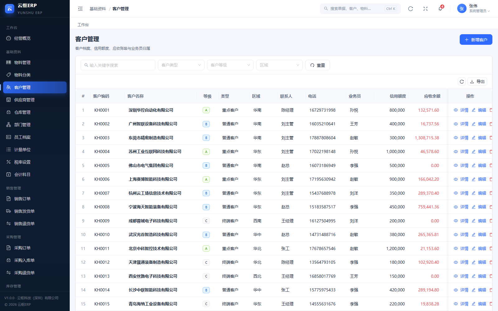

**列表列**：客户编码、名称、等级（A/B/C/D）、类型、区域、联系人、电话、业务员、信用额度、应收余额、状态。

**筛选项**：客户类型、客户等级、区域。

**关键字段**：

| 字段 | 说明 |
|---|---|
| 客户编码* / 名称* | 唯一编码 |
| 简称、客户类型、客户等级 | 类型如重点客户/经销商；等级用于分级管理 |
| 区域、所属行业 | 统计分析维度 |
| 联系人/电话/邮箱/地址/税号/开户行/账号 | 开单自动带出 |
| 信用额度、信用账期(天) | 账期用于计算发票到期日 |
| 所属业务员 | 用于业绩归属 |
| 状态 | 正常/停用 |

**操作要点**：

- 「应收余额」来自该客户未核销发票合计。
- 删除前会检查是否被业务单据或发票引用。

### 3.4 供应商管理

**路径**：`基础资料 → 供应商管理`

- 列表：供应商编码、名称、分类、区域、联系人、电话、结算方式、评级、应付余额、状态。
- 筛选项：供应商分类、评级。
- 关键字段：编码/名称、分类（原材料/包装/外协/物流/设备/办公/其他）、结算方式（现款/月结 30/60/90/预付等）、信用账期、评级（A/B/C/D）、开户行与账号。
- 应付余额来自未付发票合计。

### 3.5 仓库管理

**路径**：`基础资料 → 仓库管理`

- 维护仓库编码、名称、类型（原料仓/成品仓/半成品仓/不良品仓/委外仓/在途仓）、地址、负责人、电话、状态。
- 被单据或库存余额引用的仓库禁止删除。

### 3.6 部门与员工

**路径**：`基础资料 → 部门管理 / 员工档案`

**部门**：编码、名称、上级部门、负责人、成本中心、排序、状态；列表显示在职人数。

**员工**：工号、姓名、部门、岗位、员工类型（正式/试用/实习/外包）、性别、电话、入职日期、基本工资、状态（在职/离职/停薪留职）。

- 员工可用于单据「业务员」「负责人」「经办人」等字段选择。
- 部门用于单据归属与费用统计。

### 3.7 计量单位 / 税率

**路径**：`基础资料 → 计量单位 / 税率设置`

- 计量单位：编码、名称（如 PCS 个、SET 套、KG 千克）。
- 税率：编码、名称、税率%（默认 13/9/6/3/0 五档）。

### 3.8 会计科目

**路径**：`基础资料 → 会计科目`（需要财务权限）

- 展示科目编码、名称、类别（资产/负债/权益/成本/收入/费用）、方向、级次、末级标记、状态。
- 用于凭证、报表与 GL 映射；已使用科目不建议删除。

---

## 4. 销售管理

销售模块覆盖 **订单 → 发货 → 退货** 全流程，发货单审核时自动完成「扣库存 + 确认收入 + 结转成本 + 生成应收发票 + 生成会计凭证」。

### 4.1 销售订单

**路径**：`销售管理 → 销售订单`

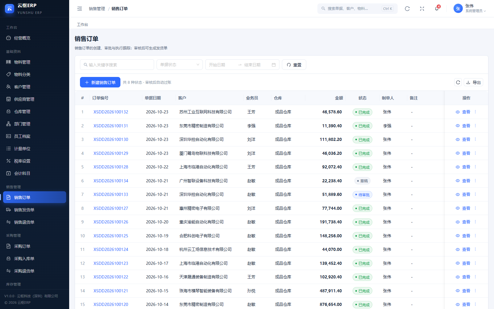

#### 列表

- 列：单据编号、单据日期、客户、业务员、仓库、金额、状态、制单人、备注、操作。
- 筛选：单据状态、日期范围；搜索支持单号/备注/客户名等；支持导出。
- 右上角「新建销售订单」。
- 行操作：查看 + 更多（编辑/打印/提交/审核/关闭/作废/删除，按状态出现）。

#### 新建/编辑

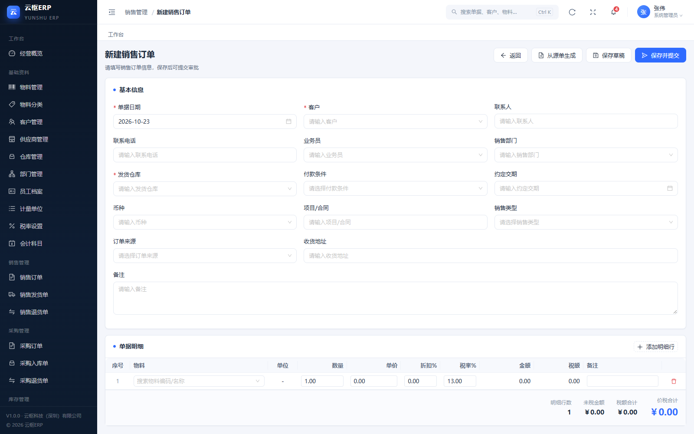

1. 点击「新建销售订单」。
2. 填写表头：单据日期（默认今天）、客户*、联系人、联系电话、业务员、销售部门、发货仓库*、付款条件、约定交期、币种、项目/合同、销售类型、订单来源、收货地址、备注。
3. 点击「添加明细行」，选择物料 → 自动带出规格/单位/税率/销售价，填写数量、单价；可按需修改折扣%、税率、行备注。
4. 检查底部合计（未税金额、税额合计、价税合计）。
5. 「保存草稿」或「保存并提交」。
6. 提交后进入详情页，点「审核」完成审批（审核后不可修改）。

**单据详情页**会展示：状态标签、可执行动作按钮、表头信息、明细行、关联发票与会计凭证、来源单据、操作日志时间线（见下图）：

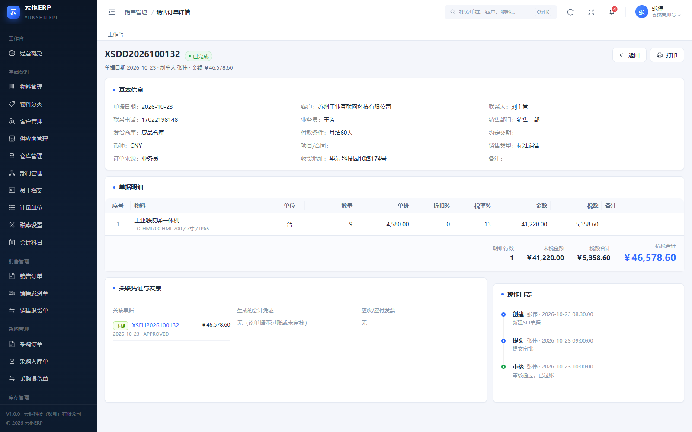

#### 状态

| 状态值 | 界面名称 | 说明 |
|---|---|---|
| `DRAFT` | 草稿 | 可编辑 |
| `SUBMITTED` | 待审批 | 等待审核 |
| `APPROVED` | 已审核 | 可发货 |
| `PARTIAL_SHIPPED` | 部分发货 | 已生成部分发货单并过账 |
| `FULL_SHIPPED` | 已发货 | 全部发货完成（系统自动推进） |
| `COMPLETED` | 已完成 | 已开票并收款完成 |
| `CLOSED` | 已关闭 | 剩余数量不再执行 |
| `VOID` | 已作废 | 单据失效 |

#### 转发货单

1. 打开已审核的销售订单详情，点「从源单生成」（或新建发货单后选择源单）。
2. 选择销售订单 → 系统带出**未发货行与剩余数量**。
3. 可修改本次发货数量（≤ 剩余数量），保存并提交 → 审核。
4. 审核后：库存减少、生成应收发票与凭证，源订单行 `已发数量` 回写，订单状态自动变为「部分发货/已发货」。

### 4.2 销售发货单

**路径**：`销售管理 → 销售发货单`

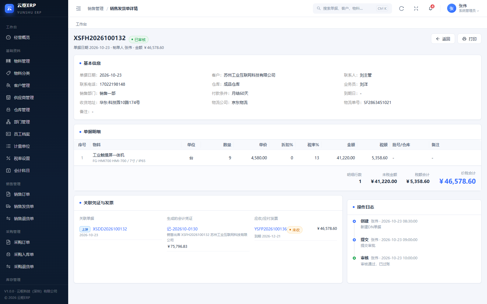

- 列表字段与订单类似（含仓库、金额、状态）；筛选项为状态 + 日期范围。
- 新建方式：直接新建（手工选物料）或从销售订单「从源单生成」。
- 表头：单据日期、客户*、联系人、电话、仓库*、业务员、部门、付款条件、到期日、收货地址、物流公司、物流单号、备注。
- 明细：物料、数量、单价、折扣、税率、金额、税额、批号/仓库、备注。
- 审核效果：
  1. 按行出库（移动加权平均成本）→ 写库存流水；
  2. 生成 **AR 应收发票**（价税合计、到期日=单据日期+客户账期）；
  3. 生成会计凭证：借 应收账款 / 贷 主营业务收入 + 销项税额；借 主营业务成本 / 贷 库存商品；
  4. 回写源订单行 `已发数量`，推进订单状态。
- 已审核发货单不可编辑；如需更正走「销售退货单」。

### 4.3 销售退货单

**路径**：`销售管理 → 销售退货单`

- 新建时可「从源单生成」选择销售发货单，带出可退数量。
- 表头含「退货原因」（质量问题/规格不符/数量差异/客户取消/发货错误/交期延误/其他）。
- 审核效果（红字反向）：库存回库（按原发货成本）→ 冲减收入与销项税额 → 冲减应收账款与主营业务成本。
- 退款流程：先做退货单，再用「收款单」做红字收款或用付款单退客户（按财务制度执行）。

### 4.4 销售操作注意事项

1. **审核前务必核对**：审核即过账，库存与凭证立即生成，无法撤销（只能红冲）。
2. **客户信用额度**：当前版本不在提交时强制拦截（额度字段已具备），请业务自行控制。
3. **价格来源**：物料选择后带出参考销售价，可在行内修改；折扣按行计算。
4. **单据编号**：系统自动生成（如 `XSDD2026100001`），不可手工修改。
5. **打印**：详情页「打印」输出 A4 单据，含价税合计中文大写。

---

## 5. 采购管理

采购模块覆盖 **订单 → 入库 → 退货** 全流程，入库单审核时自动完成「增加库存 + 生成应付发票 + 生成会计凭证」。

### 5.1 采购订单

**路径**：`采购管理 → 采购订单`

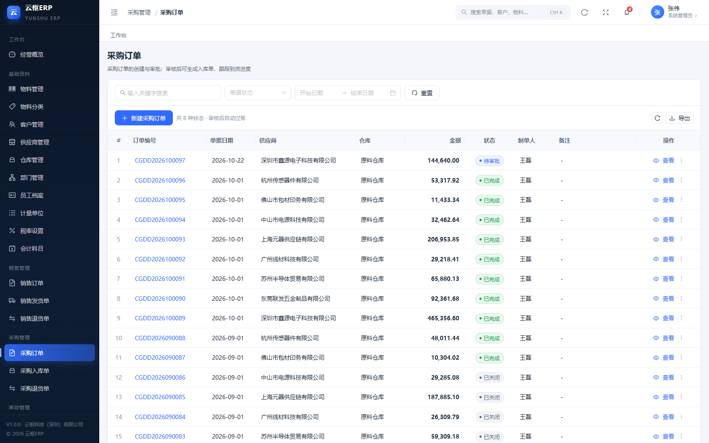

#### 列表与新建

- 列：单据编号、单据日期、供应商、仓库、金额、状态、制单人、备注、操作。
- 筛选：单据状态、日期范围；支持搜索、导出。
- 新建表头：单据日期、供应商*、联系人、电话、收货仓库*、采购部门、付款条件、约定到货日、币种、采购类型（原材料/包装物/外协加工/设备/办公用品/备品备件）、备注。
- 明细：物料、数量、单价（默认带参考采购价）、税率、金额、税额、备注。
- 操作与销售订单一致：保存草稿 / 保存并提交 / 提交 / 审核 / 关闭 / 作废 / 删除。

#### 状态

| 状态值 | 界面名称 | 说明 |
|---|---|---|
| `DRAFT` | 草稿 | 可编辑 |
| `SUBMITTED` | 待审批 | 等待审核 |
| `APPROVED` | 已审核 | 可入库 |
| `PARTIAL_RECEIVED` | 部分入库 | 已生成部分入库单并过账 |
| `FULL_RECEIVED` | 已入库 | 全部到货（系统自动推进） |
| `COMPLETED` | 已完成 | 已开票并付款完成 |
| `CLOSED` | 已关闭 | 剩余数量不再执行 |
| `VOID` | 已作废 | 单据失效 |

#### 转入库单

打开已审核采购订单详情 → 「从源单生成」→ 选择采购订单 → 带出未入库行与剩余数量 → 修改本次入库数量 → 保存并提交 → 审核。

### 5.2 采购入库单

**路径**：`采购管理 → 采购入库单`

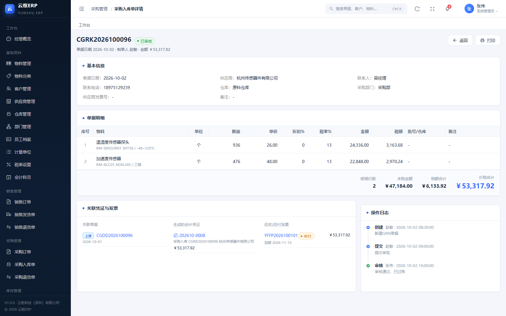

- 表头：单据日期、供应商*、联系人、电话、仓库*、采购部门、供应商发票号（可选）、备注。
- 明细：物料、数量、单价、税率、金额、税额、仓库、批号、备注。
- 审核效果：
  1. 按行入库（单价入账，重算移动加权平均成本）；
  2. 生成 **AP 应付发票**（到期日=入库日期+供应商账期）；
  3. 生成会计凭证：借 原材料/库存商品 + 进项税额 / 贷 应付账款；
  4. 回写源采购订单行已入库数量，推进订单状态。

### 5.3 采购退货单

**路径**：`采购管理 → 采购退货单`

- 可从采购入库单生成，带出可退数量。
- 表头含「退货原因」（质量问题/规格不符/数量差异/交期延误/其他）。
- 审核效果（红字反向）：库存出库（按当前均价）→ 冲减应付账款 → 冲减存货成本与进项税额转出。

### 5.4 采购操作注意事项

1. 先建供应商档案并设置账期，入库后应付发票的到期日才准确。
2. 入库数量可少于订单数量（部分入库），订单状态自动变为「部分入库」；剩余不想再收可「关闭」订单。
3. 到货价格与订单价格不一致时，按实际入库单价入账（行内可改单价）。
4. 审核后不可修改；退货请走采购退货单。

---

## 6. 库存管理

库存模块提供实时余额、流水追溯、预警、调拨、盘点、其他出入库。**所有库存变动都来自单据审核，不支持直接改库存**。

### 6.1 库存余额

**路径**：`库存管理 → 库存余额`

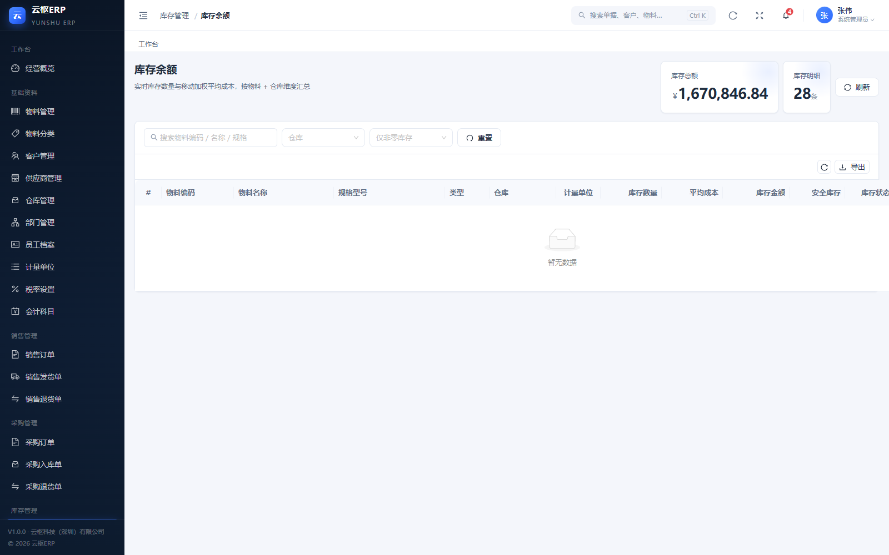

- 页头显示：库存总额、库存明细条数、刷新按钮。
- 筛选：仓库、是否只看非零库存；搜索物料编码/名称/规格。
- 列：物料编码、名称、规格、类型、仓库、单位、库存数量、平均成本、库存金额、安全库存、库存状态（正常/低于安全库存/无库存）、更新时间。
- 支持导出 CSV。

> 库存数量与金额均为实时值：数量来自库存余额表，金额 = 数量 × 移动加权平均成本。

### 6.2 库存流水

**路径**：`库存管理 → 库存流水`

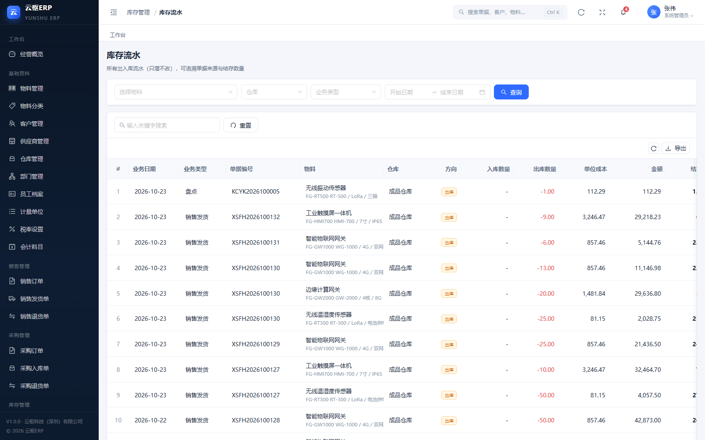

- 筛选：物料（下拉搜索）、仓库、业务类型（销售发货/销售退货/采购入库/采购退货/调拨/盘点/其他入库/其他出库/生产领料/完工）、日期范围。
- 列：业务日期、业务类型、单据编号、物料、仓库、方向（入库/出库）、入库数量、出库数量、单位成本、金额、结存数量、批号。
- 流水**只增不改**，可追溯到具体单据；用于对账与成本核查。

### 6.3 库存预警

**路径**：`库存管理 → 库存预警`

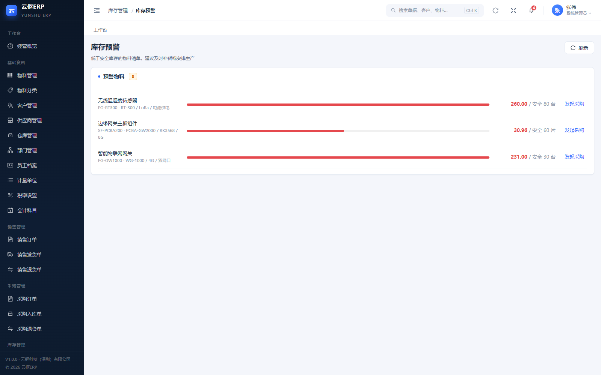

- 列出所有「当前库存 < 安全库存」的物料，显示缺口进度条与当前/安全库存。
- 点击「发起采购」跳转新建采购订单（自动跳转，需手工选择供应商与物料）。
- 页头「刷新」重新计算。

### 6.4 库存调拨单

**路径**：`库存管理 → 库存调拨单`

- 表头：调出仓库*、调入仓库*（两者不能相同）、经手人、备注。
- 明细：物料、数量、批号、备注。
- 审核效果：调出仓出库 → 调入仓入库，成本平移，**不生成会计凭证**（同一主体内部移动）。
- 适用于仓库间移库、原料仓 → 生产仓等场景。

### 6.5 库存盘点单

**路径**：`库存管理 → 库存盘点单`

- 表头：盘点仓库*、盘点类型（全盘/抽盘/循环盘点）、盘点人、备注。
- 明细：物料、**实盘数量**（填写盘点后的实际数量，不是差异）、批号、备注。
- 审核效果：系统自动比对账面数量，生成盘盈/盘亏调整：
  - 盘盈：借 库存商品 / 贷 待处理财产损溢；
  - 盘亏：借 待处理财产损溢 / 贷 库存商品。
- 注意：盘点前建议先做一次库存余额导出留档；盘点单明细只填实盘数量。

### 6.6 其他入库 / 其他出库

**路径**：`库存管理 → 其他入库单 / 其他出库单`

- 其他入库类型：盘盈入库、借入入库、样品入库、赠品入库、其他；明细可填单价（不填按标准成本）。
- 其他出库类型：盘亏出库、借出出库、样品出库、赠送出库、研发领用、其他。
- 审核后生成库存流水与对应凭证（借/贷 待处理财产损溢）。

### 6.7 库存操作注意事项

1. 任何库存变动都必须过单据；发现库存错误请用「盘点单」或「其他出入库」修正并备注原因。
2. 系统参数「允许负库存」关闭后，出库/发货/领料会校验可用库存并拒绝超卖；默认演示环境为开启，请关注「库存余额」与「库存预警」。
3. 批次管理物料在出入库时填写批号，便于后续追溯。
4. 调拨不影响总库存金额，只改变仓库分布。

---

## 7. 财务管理

财务管理覆盖 **凭证（自动 + 手工）→ 总账 → 三大报表**，以及 **发票 → 收付款 → 核销 → 账龄** 的往来管理。业务单据审核后自动生成凭证，无需手工做账；财务人员只需核对与维护。

### 7.1 财务总览

**路径**：`财务管理 → 财务总览`

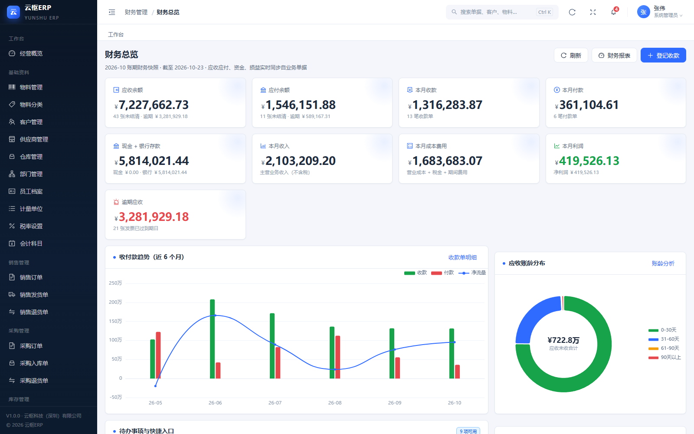

| 区域 | 内容 |
|---|---|
| 页头 | 当前账期 + 截至日期 + 「刷新」「财务报表」「登记收款」按钮 |
| KPI 卡（9 张） | 应收余额、应付余额、本月收款、本月付款、现金+银行存款、本月收入、本月成本费用、本月利润、逾期应收（含未结清张数/逾期金额） |
| 收付款趋势（近 6 个月） | 收款/付款柱状 + 净流量折线 |
| 应收账龄分布 | 环形图（0-30/31-60/61-90/90+） |
| 待办事项与快捷入口 | 登记收款、登记付款、手工凭证、应收台账、应付台账、账龄分析、科目余额表、财务报表、科目映射（按权限显示） |
| 发票口径与总账对账 | 应收/应付的「发票口径余额」vs「总账口径余额」，差异 ≤ 1 元显示绿色"一致"，否则提示核查未过账单据 |

**操作**：

1. 点击任意 KPI 卡跳转对应明细（如应收余额 → 应收台账、现金+银行 → 明细账）。
2. 点「登记收款」直接进入收款单新建页。
3. 点「财务报表」进入三大报表页。
4. 对账卡出现橙色差异时，检查是否有未审核单据或手工凭证未过账。

### 7.2 应收台账 / 应付台账

**路径**：`财务管理 → 应收台账 / 应付台账`

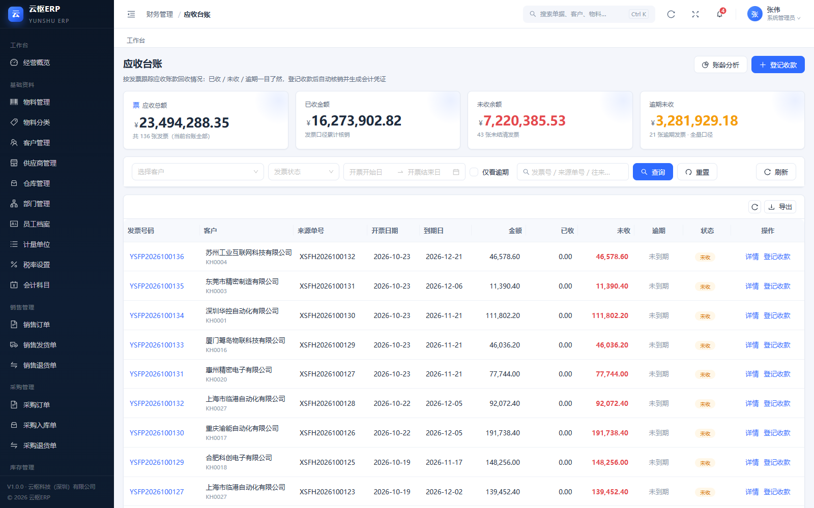

- **应收台账**：按发票跟踪应收账款回收情况（已收/未收/逾期），登记收款后自动核销并生成会计凭证。
- **应付台账**：按发票跟踪应付账款支付情况（已付/未付/逾期），登记付款后自动核销并生成会计凭证。
- 筛选：开票日期范围、关键字（发票号/来源单号/往来单位）；「查询」「重置」「刷新」。
- 列：发票号码、来源单号、往来单位、开票日期、到期日、价税合计、已收（付）金额、未收（付）金额、状态、逾期天数、操作。
- 行操作：
  - 「详情」：打开发票详情抽屉（含核销记录、关联凭证）；
  - 「修改」：修改到期日与备注（金额由来源单据控制，不可改）；
  - 「催收」（应收）/「安排付款」（应付）：跳转登记收款/付款。

### 7.3 发票管理

**路径**：`财务管理 → 发票管理`

- 顶部 Tabs 切换「应收发票 / 应付发票」。
- 列与筛选项同台账；支持查看每张发票的核销明细与关联凭证。
- 发票详情抽屉：
  - 发票信息（号码、类型、来源单据、开票日期、到期日、不含税金额、税额、价税合计、已收/已付、余额、状态）；
  - **核销记录**（收款/付款单号、核销日期、核销金额、结算方式）；
  - **关联凭证**（凭证字号、日期、摘要、借贷合计）；
  - 操作：「登记收款 / 登记付款」「查看来源单据」「修改到期日 / 备注」「关闭」。
- 提示：发票由发货单/入库单审核时自动生成，**金额不可手工修改**，只能维护到期日与备注。

### 7.4 收款单 / 付款单

**路径**：`财务管理 → 收款单 / 付款单`

- 收款单：登记客户回款，审核后自动核销应收发票并生成收款会计凭证。
- 付款单：登记供应商付款，审核后自动核销应付发票并生成付款会计凭证。
- 新建流程：
  1. 点「新建收款单 / 新建付款单」；
  2. 选择客户/供应商（自动带出联系人）；
  3. 在明细区选择**待核销发票**（可按客户过滤）并填写本次核销金额；可点「一键核销全部」引入该往来单位全部未结发票；
  4. 「保存草稿」或「保存并提交」；
  5. 审核后：发票状态自动更新（部分收款/已收），并生成「借 银行存款 / 贷 应收账款」等凭证。
- 状态：`DRAFT` 草稿 / `SUBMITTED` 待审批 / `APPROVED` 已审核 / `VOID` 已作废。

### 7.5 会计凭证

**路径**：`财务管理 → 会计凭证`

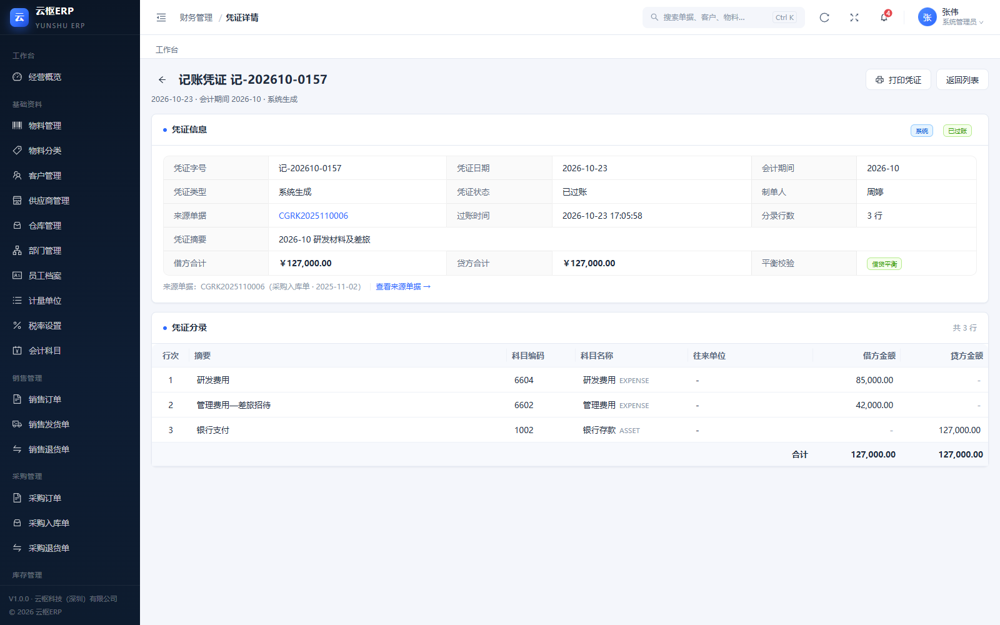

- 业务单据审核后自动生成凭证；也支持手工凭证录入，借贷平衡后直接过账。
- 筛选：会计期间（月份）、凭证类型（系统生成 / 手工凭证）、凭证状态（已过账 / 草稿）、关键字（凭证号/摘要/来源类型）；「查询」「重置」「刷新」。
- 列：凭证字号、凭证日期、会计期间、类型、摘要、来源、分录数、借方合计、贷方合计、状态、制单人。
- 行操作：「查看 / 分录」进入凭证详情（可「打印凭证」）。
- **手工凭证录入**（点「手工凭证」）：
  1. 选择凭证日期、填写凭证摘要；
  2. 点「添加分录行」，逐行选择会计科目（末级科目）、填写分录摘要与借方/贷方金额；
  3. 底部实时显示「借贷平衡 / 未平衡」，**不平衡不能保存**；
  4. 点「保存凭证」→ 保存即过账（`POSTED`），凭证不可修改。
- 凭证详情展示：凭证头、来源单据链接、过账时间、分录行数、平衡校验、分录明细表。

### 7.6 财务报表（三大表）

**路径**：`财务管理 → 财务报表`

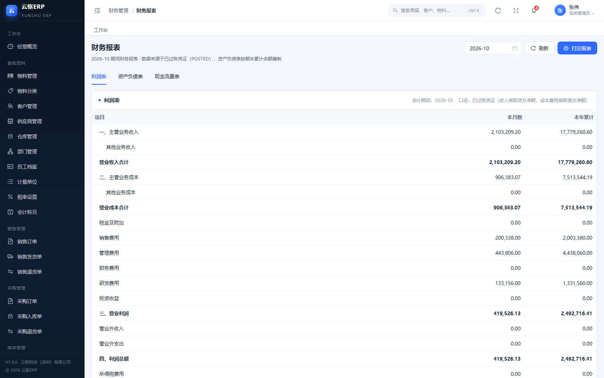

- 顶部选择**会计月份**，Tabs 切换：**利润表 / 资产负债表 / 现金流量表**。
- 利润表：本月数 + 本年累计（营业收入、营业成本、税金及附加、期间费用、营业利润、净利润等）。
- 资产负债表：期末余额（资产总计 = 负债和所有者权益总计），页头显示「平衡 ✓」或「报表不平衡」。
- 现金流量表：经营/投资/筹资分类的本月金额。
- 每张报表均可「打印」（含公司抬头、会计期间）。
- 口径说明：报表数据来源于**已过账凭证（POSTED）**；资产负债表按期末累计余额编制。

### 7.7 科目余额表

**路径**：`财务管理 → 科目余额表`

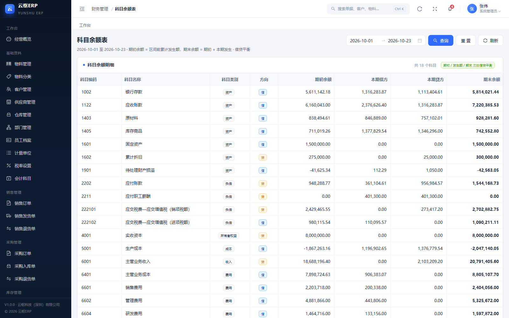

- 选择日期范围 →「查询」「重置」「刷新」。
- 列：科目编码、科目名称、科目类别、方向、期初余额、本期借方、本期贷方、期末余额。
- 页头提示「期初 / 发生额 / 期末 三处借贷平衡」或「存在不平」；出现不平需检查凭证过账与科目映射配置。

### 7.8 明细账

**路径**：`财务管理 → 明细账`

- 选择**会计科目**与日期区间 →「查询」。
- 页头 KPI：期初余额、本期借方合计、本期贷方合计、期末余额。
- 列：业务日期、凭证字号、摘要、往来单位、借方发生额、贷方发生额、余额（滚动）。
- 未选择科目时提示"请先选择会计科目，再点击「查询」查看明细账"。

### 7.9 账龄分析

**路径**：`财务管理 → 账龄分析`

- Tabs：应收账龄 / 应付账龄；可选择统计日期。
- 列：客户（供应商）、发票笔数、0-30 天、31-60 天、61-90 天、90 天以上、合计、最大逾期、最早到期日。
- 点击某行查看该往来单位的**账龄明细**弹窗（逐张发票的到期日、逾期天数、余额）。

### 7.10 科目映射

**路径**：`财务管理 → 科目映射`

- 展示业务单据自动生成凭证时使用的科目配置（业务类型、对应业务说明、科目编码、科目名称、科目类别、余额方向、操作）。
- 点「编辑」选择**末级会计科目**，保存后提示"科目映射已保存，过账与报表缓存已刷新"。
- 注意：修改映射**仅影响之后生成的凭证，历史凭证不会重算**；无 `finance.edit` 权限时只读。

### 7.11 财务操作注意事项

1. 业务单据审核即过账，**凭证与库存同步生成**；财务不需要重复录入。
2. 凭证一经保存即 `POSTED`，不可修改；如需更正请做红字凭证（当前版本手工凭证需通过反向分录处理）。
3. 发票金额由来源单据控制，只能维护到期日与备注。
4. 每月结账前建议依次检查：科目余额表平衡 → 资产负债表平衡 → 应收/应付台账余额与总账对账（财务总览对账卡）→ 账龄分析无异常长账龄。

---

## 8. 生产管理

生产管理以**生产工单**为主线：新建工单（按 BOM 展开物料与工序）→ 下达 → 开工 → 领料 → 报完工 → 关闭。领料与完工自动生成库存流水与会计凭证。

### 8.1 生产总览

**路径**：`生产管理 → 生产总览`

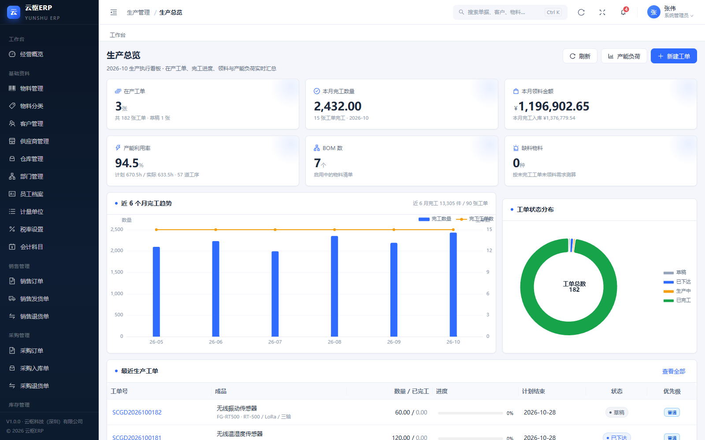

- KPI 卡：在产工单、本月完工数量、本月领料金额、产能利用率、BOM 数、缺料物料（按未完工工单未领料需求测算）。
- 图表：近 6 个月完工趋势、工单状态分布。
- 工单列表：工单号、成品、数量/已完工、进度、计划结束、状态、优先级。
- 右上角「新建生产工单」（有 `production.create` 权限时显示）。

### 8.2 生产工单

**路径**：`生产管理 → 生产工单`

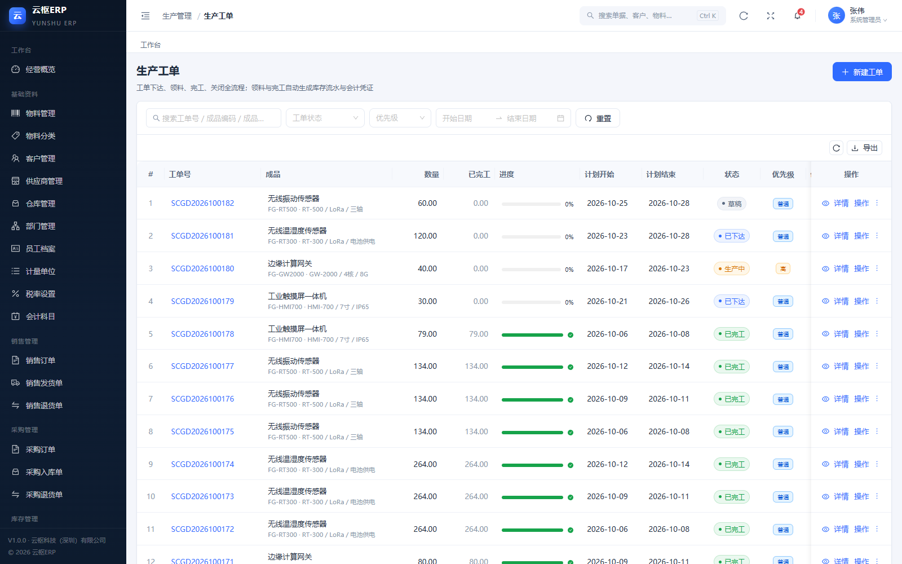

- 筛选：工单状态、计划日期、关键字（工单号/成品编码/成品名称）。
- 列：工单号、成品、数量、已完工、进度、计划开始、计划结束、状态、优先级、创建人。
- 行操作（按状态出现）：
  - 「查看」进入详情；
  - 「下达」：草稿 → 已下达（进入执行阶段，可开工、领料）；
  - 「开工」：已下达 → 生产中（记录实际开工日期）；
  - 「领料」：打开领料弹窗（生产中/已下达）；
  - 「报完工」：打开完工弹窗（生产中）；
  - 「关闭」：完工后归档，不再参与生产统计与排产；
  - 「作废」：不可恢复，不再参与 MRP 测算与排产；
  - 「删除」：仅草稿可删，删除后不可恢复。

| 状态值 | 界面名称 | 说明 |
|---|---|---|
| `DRAFT` | 草稿 | 可修改（按 BOM 重新展开物料/工序） |
| `RELEASED` | 已下达 | 可开工、可领料 |
| `IN_PROGRESS` | 生产中 | 已开工，可继续领料、报完工 |
| `COMPLETED` | 已完工 | 已入库，可关闭 |
| `CLOSED` | 已关闭 | 归档，不参与统计与排产 |
| `VOID` | 已作废 | 不可恢复 |

### 8.3 新建生产工单

**路径**：`生产管理 → 生产工单 → 新建生产工单`

- 字段：生产成品*（支持成品/半成品，选择后自动匹配启用 BOM）、生产数量*、优先级（低/普通/高/紧急）、计划开始日期*、计划完成日期*、完工入库仓库（留空自动匹配成品仓/半成品仓）、领料仓库（默认原料仓）、备注。
- 提交后系统按 BOM 自动展开**物料需求清单**与**工序计划**。
- 注意：该成品未配置启用的 BOM 时，后端会拒绝创建，需先到「BOM 管理」维护并启用。

### 8.4 工单详情

**路径**：`生产管理 → 生产工单 → 点击工单号`

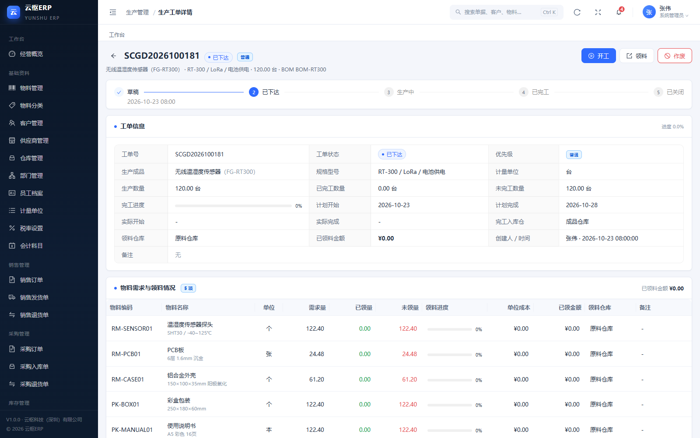

- 头部信息：工单号、工单状态、优先级、生产成品、规格/单位、生产数量、已完工数量、未完工数量、完工进度、计划/实际开始与完成、完工入库仓、领料仓库、已领料金额、创建人/时间、备注。
- **物料需求表**：物料编码/名称、单位、需求量、已领量、未领量、领料进度、单位成本、已领金额。
- **工序计划表**：序号、工序名称、工作中心、计划工时、实际工时、工时达成率、状态、操作员。
- 草稿状态下可「保存修改」（修改数量/日期/仓库后按当前启用 BOM 重新展开）。
- **领料弹窗**：填写本次领料数量、业务日期 →「确认领料」；领料后按移动加权平均成本生成库存流水（MO 出库）与凭证（借 生产成本 / 贷 原材料）。
- **报完工弹窗**：填写完工数量、业务日期，显示预计入库金额 →「确认完工」；生成成品入库流水与凭证（借 库存商品 / 贷 生产成本）。
  - 单位成本规则：**默认按「已领材料成本 × 1.18 ÷ 未完工数量」计算**；
  - 未领料直接报完工时，入库单位成本按物料标准成本估算（建议先领料再报完工以保证成本准确）。

### 8.5 BOM 管理

**路径**：`生产管理 → BOM 管理`

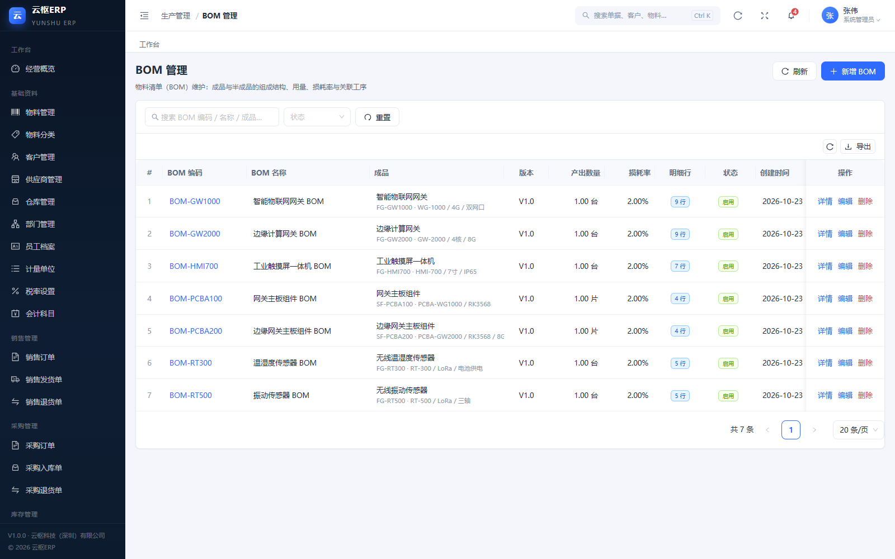

- 列表：BOM 编码、BOM 名称、成品、版本、产出数量、损耗率、明细行、状态、创建时间；支持搜索。
- 新增/编辑 BOM 表单：BOM 编码*、BOM 名称、成品/半成品*、版本、产出数量、损耗率%、关联工序（生成工单工序计划）、备注；明细行（物料、用量、损耗率、备注）。
- 领料数量公式：**工单数量 × BOM 用量 × (1 + 损耗率) ÷ BOM 产出数量**。
- 结构树展示 BOM 组成；删除会同时删除明细行，**若已被生产工单引用则不允许删除**。
- 注意：修改 BOM 不会影响已下达的工单（工单在创建时已展开快照）。

### 8.6 物料需求计划（MRP）

**路径**：`生产管理 → 物料需求计划`

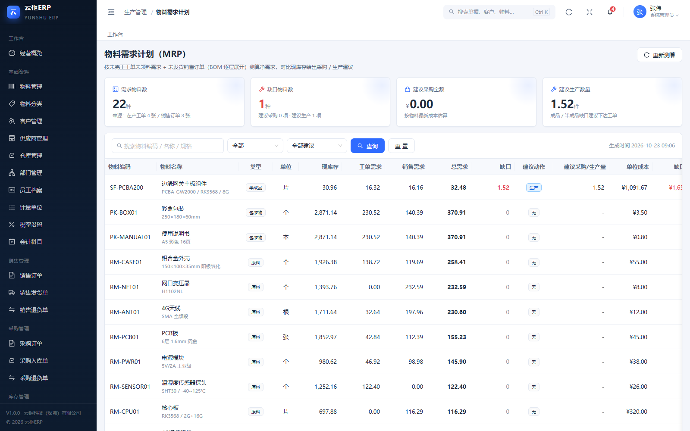

- 测算口径：**未完工工单的未领料需求 + 未发货销售订单（BOM 逐层展开）− 现库存 = 净需求**，给出采购/生产建议。
- KPI：需求物料数、缺口物料数、建议采购金额（按最新成本估算）、建议生产数量。
- 筛选：缺口 / 充足 / 采购 / 生产 / 全部建议；关键字搜索物料。
- 列：物料编码、名称、类型、单位、现库存、工单需求、销售需求、总需求、建议动作、建议采购/生产量、单位成本、缺口金额、需求来源、状态。

### 8.7 工作中心负荷

**路径**：`生产管理 → 工作中心负荷`

- KPI：综合负荷率、预计人工成本（按实际工时 × 小时费率）。
- 列：编码、工作中心、类型、日产能(工时)、月度产能(工时)、利用率、工单数、工序数、计划工时、实际工时、小时费率。
- 用于识别产能瓶颈、安排加班或外协。

### 8.8 排产看板

**路径**：`生产管理 → 排产看板`

- 统计卡：排产工单（已下达 + 生产中）、待开工、正在执行、逾期工单。
- 工单按**计划开始日期**分组展示：逾期 / 今天 / 明天 / 未排期；每张卡片显示工单号、成品、数量/已完工、进度、状态、优先级、物料齐套率、计划完成、剩余天数。
- 状态筛选：全部状态 / 已下达 / 生产中。
- 提示：只有「已下达」与「生产中」的工单会出现在排产看板。

### 8.9 工序与工作中心

**路径**：`生产管理 → 工序与工作中心`

- 上半区「工作中心」：编码、名称、类型（加工中心/装配线/测试中心/包装线/外协单位）、日产能(工时)、小时费率、状态；支持新增/编辑/删除。
- 下半区「工序档案」：工序编码、工序名称、所属工作中心、标准工时(小时)、说明；支持新增/编辑/删除。
- BOM 关联工序后，创建工单会自动生成工序计划。

### 8.10 生产操作注意事项（含 3 条已知限制）

1. **完工单位成本**：由后端按「已领材料成本 × 1.18 ÷ 未完工数量」计算（1.18 为人工与制造费用估算系数），不是精确成本核算；未领料时按标准成本估算。
2. **BOM 权限**：BOM 维护页面走 `basedata.*` 权限（与基础资料一致），而不是 `production.*`；只读角色无法维护 BOM。
3. 工单领料/完工必须按「先领料、后完工」的顺序，否则成本会按标准成本估算。
4. 工单一旦「已下达」，BOM 变更不影响该工单（快照已展开）；如需调整请作废重开。

---

## 9. 人力资源

### 9.1 人事总览

**路径**：`人力资源 → 人事总览`

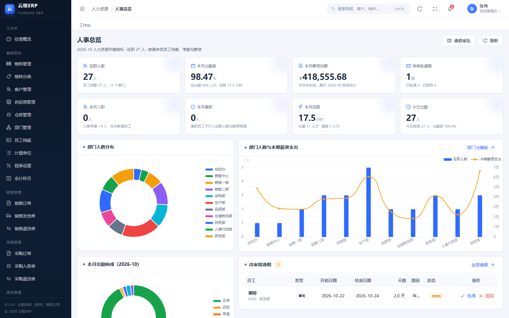

- KPI：在职人数、本月出勤率、本月薪资总额、待审批请假、本月入职、本月离职、本月加班（小时）。
- 今日出勤：出差 / 请假人次。
- 图表：部门人数分布（部门人数与本期薪资支出）。
- 待审批请假列表：员工、类型、起止日期、天数、原因、状态、操作（**批准 / 驳回**，二次确认）。
- 说明：离职员工不计入在职人数与薪资核算。

### 9.2 考勤管理

**路径**：`人力资源 → 考勤管理`

- 筛选：员工、日期范围；支持搜索工号/姓名。
- 「生成当月考勤」：选择月份 →「开始生成」，批量生成该月考勤（正常/迟到/早退/缺勤/请假/出差/加班）。
- 表格支持**行内编辑**：考勤状态、上班时间、下班时间、工作时长、加班时长、备注；改完点「保存」。
- 底部显示当前筛选合计（各状态人次）。

### 9.3 薪资管理

**路径**：`人力资源 → 薪资管理`

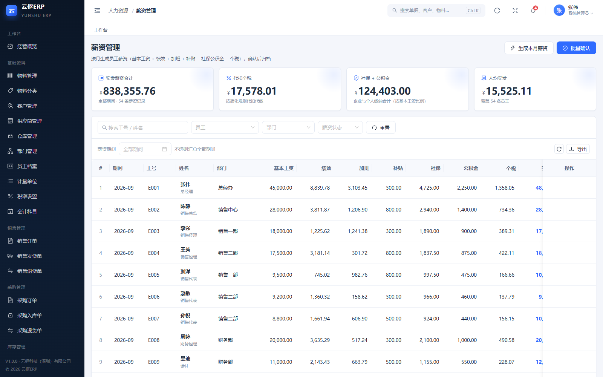

- 筛选：薪资期间（含"全部期间"）、员工、薪资状态（草稿/已确认/已发放）。
- 「生成薪资」：选择期间 →「开始生成」，按月生成员工薪资（基本工资 + 绩效 + 加班 + 补贴 − 社保公积金 − 个税）。
- 「批量确认」：将该期间全部「草稿」记录确认为「已确认」（确认后金额不可修改，需二次确认"确认无误"）。
- KPI：实发薪资合计、代扣个税、社保+公积金、人均实发。
- 列：期间、工号、姓名、部门、基本工资、绩效、加班、补贴、社保、公积金、个税、实发工资、状态。
- 说明：薪资状态为 草稿 → 已确认 → 已发放；离职员工不参与薪资核算。

### 9.4 请假管理

**路径**：`人力资源 → 请假管理`

- 顶部 Tabs：待审批 / 已批准 / 已驳回（带数量）。
- 列表：工号、姓名、部门、起止日期、天数、状态、审批人、提交时间。
- 「新增」：员工*、请假类型*（事假/病假/年假/调休/婚假/产假/丧假）、开始日期*、结束日期*、请假天数（留空则按工作日自动计算）、请假原因。
- 行操作：编辑 / 删除（待审批单）、批准 / 驳回（二次确认）。
- 批准后人事总览的"待审批请假"同步减少。

### 9.5 部门与编制

**路径**：`人力资源 → 部门与编制`

- 只读统计表：部门编码、名称、上级部门、负责人、成本中心、在职人数、排序、状态；并展示基本工资合计/平均/最高等编制信息。
- 如需新增/修改部门，请到 `基础资料 → 部门管理`（本页仅查看统计）。

### 9.6 人力资源注意事项

1. 考勤与薪资均按「员工 + 期间」维度生成，重复生成会覆盖/跳过已有记录（按页面提示操作）。
2. 薪资「已确认」后金额不可修改，请先核对再批量确认。
3. 请假审批需要 `hr.*` 权限（管理员或人事角色）。

---

## 10. 客户关系（CRM）

### 10.1 销售漏斗总览

**路径**：`客户关系 → 销售漏斗总览`

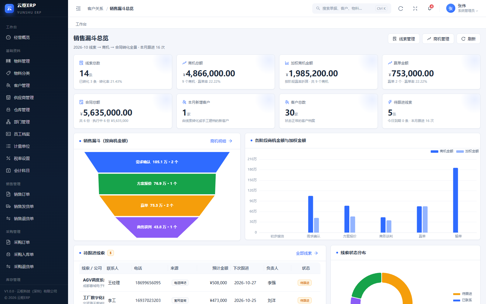

- KPI：线索总数、商机总额、加权商机金额、赢单金额、合同总额、本月新增客户、客户总数、待跟进线索。
- 图表：销售漏斗（按商机金额）、线索状态分布。
- 待跟进线索列表：线索/公司、联系人、电话、来源、预计金额、下次跟进（逾期标记）、负责人、状态。

### 10.2 线索管理

**路径**：`客户关系 → 线索管理`

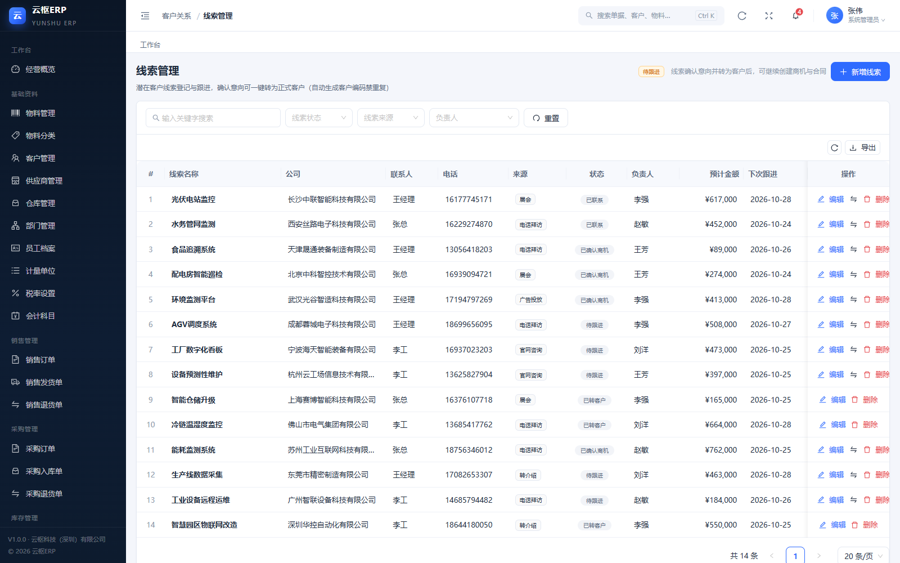

- 筛选：线索状态（待跟进/已联系/已确认商机/已转客户/已流失）、线索来源、关键字。
- 列：线索名称、公司、联系人、电话、来源、状态、负责人、预计金额、下次跟进。
- 「新增 / 编辑」：线索名称、公司名称、联系人、电话、邮箱、来源、状态、负责人、预计金额、下次跟进日期、备注。
- 「转为客户」：确认后自动生成客户档案（客户编码自动生成、禁止重复），线索状态变为「已转客户」。

### 10.3 商机管理

**路径**：`客户关系 → 商机管理`

- 筛选：商机阶段（初步接洽/需求确认/方案报价/商务谈判/赢单/输单）、商机状态（进行中/已赢单/已输单）、关键字。
- 列：商机名称、客户、商机金额、阶段、赢率、预计成交、负责人、状态。
- 「推进阶段」：选择新阶段（系统按阶段自动更新赢率与状态）、填写赢率、预计成交日期、备注 → 确认。
- 赢单/输单后商机状态自动更新，并计入 CRM 总览的赢单金额。

### 10.4 跟进记录

**路径**：`客户关系 → 跟进记录`

- 两种视角：**时间线** / **表格**。
- 「新增跟进」：关联类型（线索/客户/商机）→ 关联对象（搜索选择）→ 跟进方式（电话沟通/上门拜访/邮件往来/会议/演示/其他）→ 跟进时间 → 跟进主题 → 沟通内容。
- 支持编辑与删除；时间线按时间倒序展示沟通轨迹。

### 10.5 合同管理

**路径**：`客户关系 → 合同管理`

- KPI：合同总额、执行中金额、平均合同金额、合同数量。
- 筛选：合同状态（草稿/执行中/已完成/已终止）、关键字（合同号/合同名称/客户名称）。
- 列：合同号、合同名称、客户、合同金额、签订日期、生效日期、到期日期、合同状态、负责人。
- 「新增 / 编辑」：合同名称*、客户、合同金额、签订日期、生效日期、到期日期、合同状态、负责人、备注；**合同编号由系统按年度自动生成**。
- 删除后不可恢复。

### 10.6 客户贡献排行

**路径**：`客户关系 → 客户贡献排行`

- 统计口径：按销售发货单（已审核及之后状态）汇总客户贡献，默认统计近 12 个月。
- KPI：上榜客户数、客户贡献总额、贡献毛利、贡献第一客户。
- 图表：客户贡献 TOP10（金额）、TOP10 客户毛利率。
- 表：排名、客户编码、客户名称、等级、区域、订单数、销售额、价税合计、毛利率、平均单笔、最近下单。

### 10.7 CRM 注意事项

1. 线索「转为客户」后不可再作为线索跟进，历史跟进记录仍保留。
2. 商机阶段推进时赢率自动更新（可手工覆盖），赢单/输单会锁定状态。
3. 合同金额统计口径为合同台账金额，不等同于销售订单金额。

---

## 11. 系统管理

> 系统管理多为管理员操作，普通角色只能看到部分页面（如个人信息）。修改权限、参数前请确认影响范围。

### 11.1 用户管理

**路径**：`系统管理 → 用户管理`

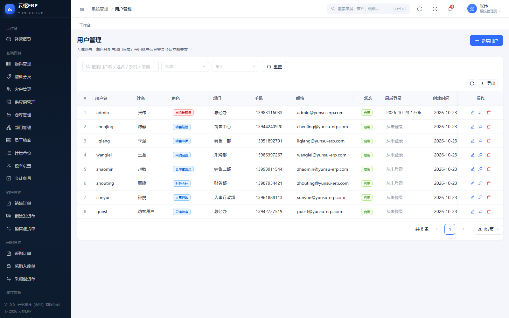

- 搜索：用户名/姓名/手机/邮箱；筛选：状态（启用/停用）、角色、部门。
- 列：用户名、姓名、角色、部门、手机、邮箱、状态、最后登录、创建时间、操作。
- 「新增用户」：用户名*（3-32 位字母/数字/_ . -）、姓名*、初始密码*（至少 6 位）、角色、所属部门、关联员工、手机、邮箱、状态。
- 行操作：编辑、**重置密码**（输入新密码并确认）、删除（不可恢复，该用户会话立即失效）。
- 说明：停用账号后其登录会话立即失效。

### 11.2 角色权限

**路径**：`系统管理 → 角色权限`

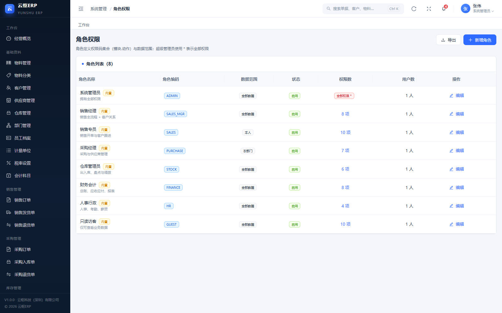

- 列：角色名称、角色编码、数据范围（全部/本部门/本人）、状态、权限数、用户数、操作；支持导出。
- 「新增角色 / 修改」：角色名称*、角色编码*（2-31 位大写字母/数字/下划线，以字母开头；内置角色编码不可改）、数据范围*、状态、角色说明。
- **权限明细**：按模块（工作台/基础资料/销售/…）分组，逐项勾选动作（查看/新建/编辑/删除/提交/审核/导出）；每个模块可一键全选/全不选。
- 超级管理员使用 `*` 表示全部权限（红色标签"全部权限 *"）。
- 保存后权限以**显式权限码**存储（如 `sales.approve`、`sales.*`）。
- 删除保护：该角色下仍有用户时禁止删除，需先调整用户角色。
- 提示：权限修改后，相关用户需**重新登录或刷新页面**才会生效（前端菜单/按钮按最新权限渲染）。

### 11.3 系统参数

**路径**：`系统管理 → 系统参数`

- **公司信息**（用于单据打印、抬头与对外信息展示）：公司名称、联系电话、纳税人识别号、公司地址、开户银行、银行账号。
- **财务与业务参数**：会计年度起始月（影响报表年度口径）、默认税率(%)（新建单据默认税率）、允许负库存（开启后库存不足仍可出库，适合先出后入场景）。
- 「保存」后立即生效（单据打印抬头与默认值同步更新）。
- 无「系统管理-编辑」权限时参数仅可查看，页面会提示。

### 11.4 个人信息

**路径**：`系统管理 → 个人信息`（也可从右上角头像菜单进入）

- 展示：登录账号、姓名、角色、所属部门、手机、邮箱、数据范围（全部数据/本部门数据/本人数据）、最后登录、我的权限（权限码标签）。
- **修改密码**：原密码、新密码（至少 6 位、不超过 64 位）、确认新密码；修改成功后需「重新登录」。

### 11.5 操作日志

**路径**：`系统管理 → 操作日志`

- 记录登录、增删改、审核、过账等关键操作，用于追溯与合规检查。
- 筛选：日期范围、关键字（操作人/详情/对象ID）。
- 列：时间、操作人、动作、模块、对象、详情、IP 地址。

### 11.6 单据号规则

**路径**：`系统管理 → 单据号规则`

- 列：单据类型、单号前缀、当前序号、流水位数、日期段格式、单号示例、操作。
- 「编辑」：单号前缀*（≤20 字符）、日期段格式（支持 `yyyy` / `MM` / `dd` 组合，留空表示无日期段）、流水号位数（1-10）、下一个流水号。
- 说明：修改下一个序号可跳号或回补；修改后新单据立即按新规则生成，历史单号不变。

### 11.7 通知公告

**路径**：`系统管理 → 通知公告`

- 筛选：通知级别（通知/提醒/预警）、状态（未读/已读）、关键字。
- 「新建通知」：通知级别*、通知标题*（≤100 字）、通知内容*、接收人（留空表示全体用户）→「发布」。
- 行操作：查看（详情弹窗）、标记已读、删除。
- 说明：未读通知会显示在右上角消息铃铛中，点击「查看全部」进入本页。

### 11.8 系统信息

**路径**：`系统管理 → 系统信息`

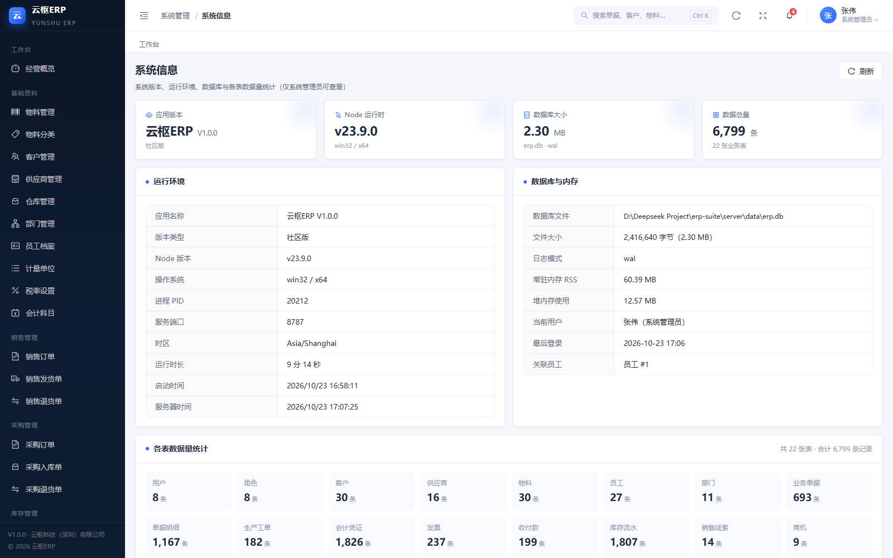

- 运行环境：应用名称、版本类型（社区版）、Node 版本、操作系统、进程 PID、服务端口、时区、运行时长、启动时间、服务器时间、数据库文件、文件大小、日志模式、常驻内存 RSS、堆内存使用、当前用户、最后登录、关联员工。
- 数据量统计：用户、角色、客户、供应商、物料、员工、部门、业务单据、单据明细、生产工单、会计凭证、发票、收付款、库存流水、销售线索、商机、合同、考勤、薪资、请假、通知、审计日志等表的记录数。
- 仅系统管理员可查看（`system.view`）。

### 11.9 系统管理注意事项

1. 删除用户/角色前先确认无关联数据（角色有用户时禁止删除）。
2. 修改角色权限后相关用户需重新登录/刷新。
3. 「允许负库存」开启时出库不做库存校验，请谨慎使用。
4. 单据号规则修改只影响新单据，不会重排历史单号。

---

## 12. 报表中心

> 通用交互：多数报表顶部有**范围选择**（本月 / 近3月 / 近12月 / 今年，或自定义日期区间）与「刷新数据」按钮；表格支持排序、导出（部分报表）；图表随范围联动。

### 12.1 经营驾驶舱

**路径**：`报表中心 → 经营驾驶舱`

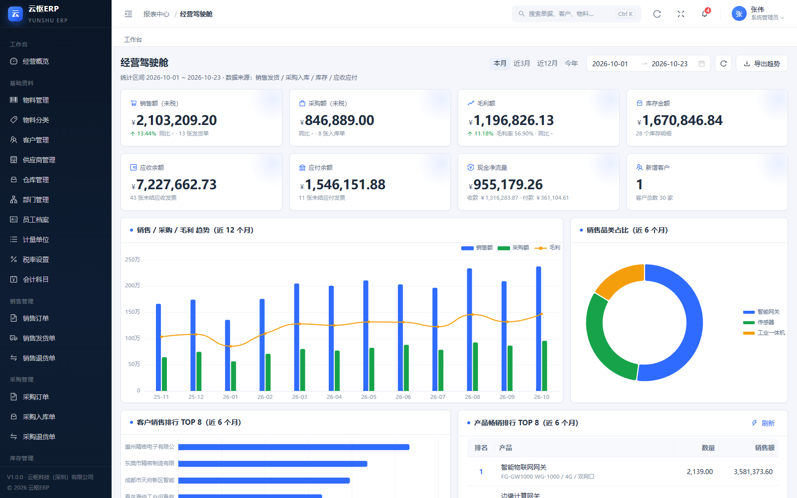

- KPI：销售额（未税）、采购额（未税）、毛利额/毛利率（含同比）、库存金额、应收余额、应付余额、现金净流量、新增客户，以及扩展指标（在产工单、本月完工数量、在职人数、最新薪资期间、实发工资合计）。
- 图表：销售/采购/毛利趋势（近 12 个月）、销售品类占比（近 6 个月）、客户销售排行 TOP 8（近 6 个月）。
- 表格：产品排行（排名、产品、数量、金额等）。
- 顶部可选择统计区间并「刷新数据」。
- 注意：本页部分图表数据来自工作台接口（`dashboard.view`），若账号只有 `reports.view` 而缺少 `dashboard.view`，对应图表可能为空（见 `08-交付验收报告.md` 已知限制）。

### 12.2 销售汇总表

**路径**：`报表中心 → 销售汇总表`

- Tabs：**按客户 / 按产品 / 按业务员**。
- 范围选择 + 刷新；表格汇总销售额（未税）、销售成本、毛利额、毛利率等；支持关键字搜索与导出。

### 12.3 销售趋势分析

**路径**：`报表中心 → 销售趋势分析`

- KPI：毛利额、月均销售额等。
- 图表：销售额 / 销售成本 / 毛利率 月度趋势。
- 表：月份、订单数、销售数量、销售额（未税）、税额、价税合计、销售成本、毛利、毛利率、环比、同比。

### 12.4 采购汇总表

**路径**：`报表中心 → 采购汇总表`

- Tabs：**按供应商 / 按产品 / 按月**。
- KPI：采购金额、订单数、进项税额（含进项）。
- 图表：采购金额 / 订单数 月度趋势。
- 表：供应商/产品/月份、采购数量、采购金额（未税）、税额、价税合计、环比等。

### 12.5 库存分析

**路径**：`报表中心 → 库存分析`

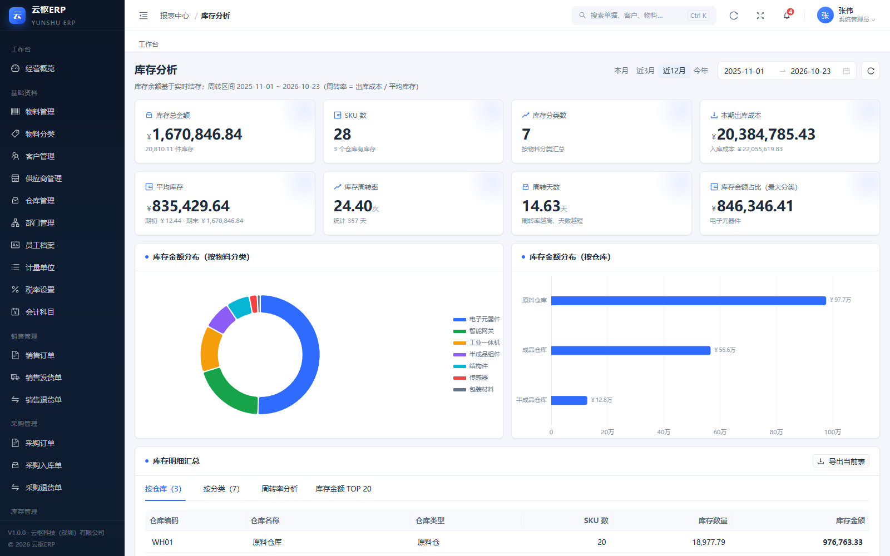

- Tabs：**按仓库 / 按分类 / 周转率 / 库存金额 TOP20**。
- KPI：库存总金额、库存分类数、本期出库成本、库存周转率、最大分类占比。
- 图表：库存金额分布（按物料分类 / 按仓库）。
- 表：仓库或分类维度的 SKU 数、库存数量、库存金额；周转率维度含期初/期末/平均库存、周转率(次)、周转天数；TOP20 含产品编码/名称/规格/单位/平均成本/库存金额。

### 12.6 毛利分析

**路径**：`报表中心 → 毛利分析`

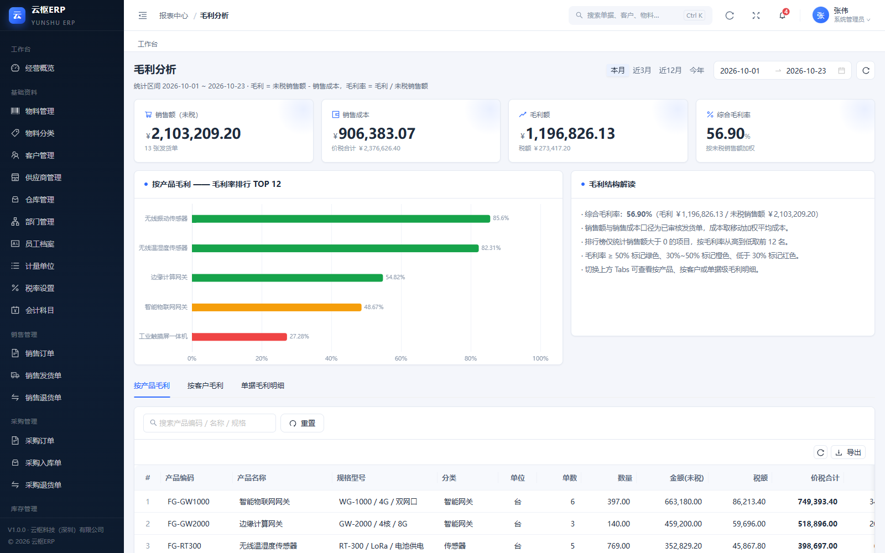

- Tabs：**按产品 / 按客户 / 单据明细**。
- KPI：销售额（未税）、毛利额、综合毛利率（按未税销售额加权）。
- 表：产品/客户维度含销售额、税额、价税合计、销售成本、毛利、毛利率；单据明细含单据编号、日期、客户、业务员、金额与毛利。
- 支持按产品/客户/单据号搜索。

### 12.7 客户贡献分析

**路径**：`报表中心 → 客户贡献分析`

- ABC 分级：A 类（累计贡献 ≤70%，核心客户）、B 类（70%~90%，重点维护）、C 类（>90%，长尾客户）。
- KPI：成交客户数、客户销售总额、A 类核心客户、B/C 类客户。
- 图表：客户销售额排行 TOP15（颜色区分 ABC 分级）、ABC 客户数量分布。
- 表：排名、客户编码、名称、等级、地区、单数、销售额(未税)、价税合计、毛利、毛利率、销售占比、累计占比。

### 12.8 产品畅销榜

**路径**：`报表中心 → 产品畅销榜`

- 切换「按金额排行 / 按数量排行」。
- KPI：上榜产品数、销售额合计、销售数量合计、榜首产品。
- 表：排名、产品编码、名称、规格、分类、单位、销售单数、销售数量、数量占比、销售额(未税)、金额占比、销售成本、毛利、毛利率。

### 12.9 报表使用注意事项

1. 报表口径：销售额默认**未税**（另有价税合计列），成本来自发货时的移动加权平均成本。
2. 范围选择影响所有图表与表格；切换后请等待数据刷新。
3. 报表只读，不产生任何业务数据；导出为 CSV。
4. 经营驾驶舱部分图表依赖 `dashboard.view`（见已知限制）。

---

## 附录 A：状态字典

### A.1 业务单据主状态

| 界面名称 | 状态值 | 说明 |
|---|---|---|
| 草稿 | `DRAFT` | 可编辑，未过账 |
| 待审批 | `SUBMITTED` | 已提交，等待审核 |
| 已审核 | `APPROVED` | 已过账，不可编辑 |
| 部分发货 | `PARTIAL_SHIPPED` | 销售订单部分行已发货 |
| 已发货 | `FULL_SHIPPED` | 销售订单全部发货 |
| 部分入库 | `PARTIAL_RECEIVED` | 采购订单部分到货 |
| 已入库 | `FULL_RECEIVED` | 采购订单全部到货 |
| 已完成 | `COMPLETED` | 全流程完成 |
| 已关闭 | `CLOSED` | 剩余数量不再执行 |
| 已作废 | `VOID` | 单据失效 |

### A.2 发票状态

| 类型 | 状态 |
|---|---|
| 应收发票（AR） | 未收 / 部分收款 / 已收 / 已核销 / 已作废 |
| 应付发票（AP） | 未付 / 部分付款 / 已付 / 已核销 / 已作废 |

### A.3 生产工单状态

| 界面名称 | 状态值 | 说明 |
|---|---|---|
| 草稿 | `DRAFT` | 可修改，按 BOM 重新展开 |
| 已下达 | `RELEASED` | 可开工、领料 |
| 生产中 | `IN_PROGRESS` | 已开工，可领料、报完工 |
| 已完工 | `COMPLETED` | 已入库，可关闭 |
| 已关闭 | `CLOSED` | 归档，不参与统计/排产 |
| 已作废 | `VOID` | 不可恢复 |

### A.4 其他业务状态

| 对象 | 状态 |
|---|---|
| 凭证 | `POSTED` 已过账 / `DRAFT` 草稿（手工凭证保存即过账） |
| 收付款单 | 草稿 / 待审批 / 已审核 / 已作废 |
| 考勤 | 正常 / 迟到 / 早退 / 缺勤 / 请假 / 出差 / 加班 |
| 薪资 | 草稿 / 已确认 / 已发放 |
| 请假 | 待审批 / 已批准 / 已驳回 |
| 线索 | 待跟进 / 已联系 / 已确认商机 / 已转客户 / 已流失 |
| 商机阶段 | 初步接洽 / 需求确认 / 方案报价 / 商务谈判 / 赢单 / 输单 |
| 商机状态 | 进行中 / 已赢单 / 已输单 |
| 合同 | 草稿 / 执行中 / 已完成 / 已终止 |
| 通知级别 | 通知 / 提醒 / 预警 |

## 附录 B：常见操作问题

| 问题 | 解决 |
|---|---|
| 新建单据时客户/物料下拉为空 | 先去基础资料新增并确认状态为「正常/启用」 |
| 选物料后价格为 0 | 物料档案未维护参考价，可手工填写单价 |
| 点「审核」提示"当前状态不允许" | 先「提交」，再「审核」；或该单据已被处理过 |
| 审核后想改数量 | 已审核不可改：销售/采购走退货单 + 重新开单；库存差异走盘点单 |
| 审核后没看到应收/应付发票 | 确认审核是否成功（状态应为已审核）；到财务 → 发票管理按来源单号查询 |
| 凭证借贷不平/无法保存 | 检查科目映射是否指向有效末级科目；手工凭证需借贷合计相等 |
| 列表看不到某张单据 | 检查状态筛选与日期范围；或用 Ctrl+K 全局搜索单号 |
| 导出文件中文乱码 | 用 Excel 打开 CSV（已带 UTF-8 BOM）；勿用记事本另存 |
| 打印内容为空 | 使用浏览器打印预览，勾选背景图形；仅单据区域会被打印 |
| 工单无法下达/开工 | 确认工单状态为草稿/已下达，且具备 production.* 权限 |
| 完工入库成本异常 | 先完成领料再报完工；单位成本按「已领材料成本 × 1.18 ÷ 未完工数量」计算 |
| BOM 页面无法新增/编辑 | BOM 维护走 basedata.* 权限，请使用管理员或采购/基础资料角色 |
| 报表图表为空 | 检查统计范围是否有数据；经营驾驶舱部分图表还需要 dashboard.view 权限 |
| 修改角色权限后菜单没变化 | 退出重新登录或刷新页面（权限在前端启动时加载） |
| 重置密码后登录失败 | 使用管理员设置的新密码；密码区分大小写 |
| 登录后马上退出 | 会话过期或服务重启过，重新登录即可 |

---

**更新记录**

| 日期 | 版本 | 说明 |
|---|---|---|
| 2026-10-23 | v1.0（第一部分） | 完成登录/工作台/基础资料/销售/采购/库存章节 |
| 2026-10-23 | v1.0（完整版） | 补全财务/生产/人力资源/客户关系/系统管理/报表中心六章；截图更新为 33 张最终版；状态字典与常见问题扩充 |
